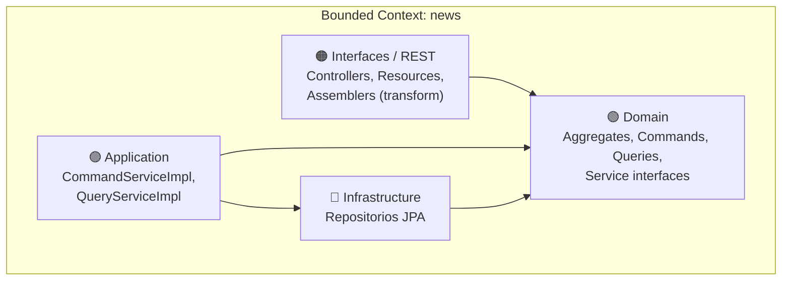
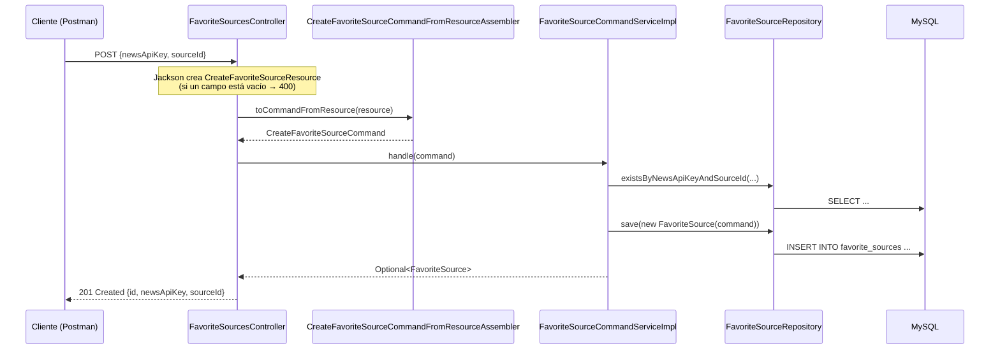
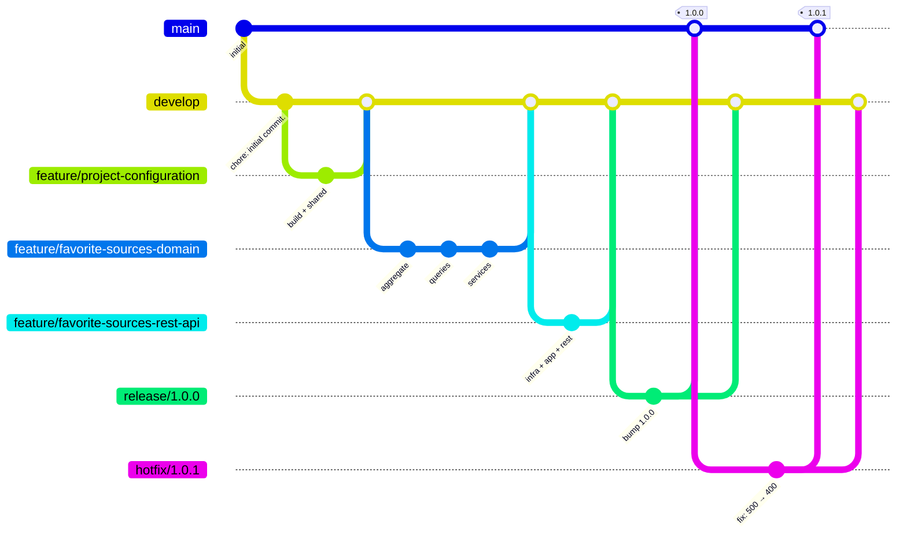
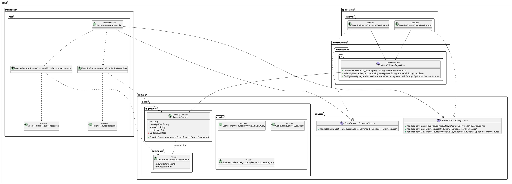

# 📘 Guía Completa de Desarrollo — CatchUp Platform

## API REST de fuentes favoritas con Spring Boot 3.5, Java 24, Spring Data JPA, MySQL, Domain-Driven Design (DDD), GitFlow y Postman

---

> [!IMPORTANT]
> Esta guía construye **desde cero** el backend `catch-up-platform`: una API REST que amplía la app Angular **CatchUp** (cliente de NewsAPI) permitiendo **guardar fuentes de noticias favoritas**. Sigue un flujo **progresivo** con **DDD** (Domain → Infrastructure → Application → Interfaces), **GitFlow** con ramas `feature/`, `release/` y `hotfix/`, **Conventional Commits**, **Semantic Versioning** y pruebas de API con **Postman**. Cada paso explica **QUÉ** genera la herramienta por defecto y **POR QUÉ** se modifica.
>
> El código es el mismo del documento original *catch-up-platform* (paquete `com.acme.catchup.platform`). Lo que se agrega en esta guía (colección Postman, user stories, diagrama, hotfix) está marcado como tal.

> [!NOTE]
> **Verificado:** el código de esta guía se compiló con **JDK 24** y **Spring Boot 3.5.0**, se ejecutó y se probó con la colección Postman incluida (vía Newman). Para la prueba se usó una base **H2 en memoria** en lugar de MySQL; con MySQL el comportamiento de la API es el mismo.

---

## Tabla de Contenidos

| Fase | Pasos | Descripción |
|:-----|:------|:------------|
| **Fase 0** | 1–6 | Herramientas, MySQL, creación del proyecto, GitFlow, dependencias y configuración (Shared BC) |
| **Fase 1** | 7–9 | News Bounded Context — Domain (Aggregate, Command, Queries, Service contracts) |
| **Fase 2** | 10 | News Bounded Context — Infrastructure (Repository JPA) |
| **Fase 3** | 11 | News Bounded Context — Application (Command/Query Services) |
| **Fase 4** | 12–14 | News Bounded Context — Interfaces/REST (Resources, Assemblers, Controller) |
| **Fase 5** | 15–16 | Ejecución, verificación en MySQL y Swagger UI |
| **Fase 6** | 17–20 | Pruebas de la API con Postman (colección, environment, tests, Newman) |
| **Fase 7** | 21 | Documentación (README, User Stories, Diagrama de clases) |
| **Fase 8** | 22–24 | Release con GitFlow, push a GitHub y hotfix (manejador global de errores) |
| **Anexos** | — | Observaciones del código, mejoras opcionales, resumen de commits, referencias |

---

## Convenciones de la Guía

| Icono | Significado |
|:------|:------------|
| 💻 | Ejecutar comando en terminal |
| 📁 | Archivo o directorio creado |
| ✏️ | Editar / Reemplazar contenido |
| 🔀 | Realizar commit |
| 🌿 | Operación de rama (branch) |
| 💡 | Explicación de por qué se hace así |
| ⚙️ | Lo que la herramienta genera por defecto |
| 📮 | Paso en Postman |
| 🐬 | Paso en MySQL |
| ⚠️ | Advertencia o buena práctica importante |

> [!NOTE]
> Los comandos se muestran para **Git Bash** (`./mvnw`). En **PowerShell** o **CMD** usa `.\mvnw.cmd`.

---

## Herramientas y Prerrequisitos

| Herramienta | Versión | Para qué se usa | Verificación |
|:-----------|:--------|:----------------|:-------------|
| JDK | **24** (OpenJDK, Corretto, Temurin…) | Compilar y ejecutar | `java -version` |
| Maven | 3.9.x vía **Maven Wrapper** (`mvnw`) | Build y dependencias | `./mvnw -v` |
| **MySQL Server** | 8.x | Base de datos | `mysql --version` |
| MySQL Workbench *(o el panel Database de IntelliJ Ultimate)* | 8.x | Ver tablas y datos | — |
| Git | 2.x+ | Control de versiones | `git --version` |
| Git Flow AVH | Incluido en Git for Windows | Flujo de ramas GitFlow | `git flow version` |
| IntelliJ IDEA **Ultimate** | 2025.x+ | IDE (generador Spring Boot integrado) | — |
| **Postman** | Última | Probar y documentar la API | — |
| Node.js *(opcional)* | 22+ | Ejecutar la colección con **Newman** | `node --version` |
| Docker Desktop *(opcional)* | Última | Levantar MySQL sin instalarlo | `docker --version` |

> [!WARNING]
> **Versiones.** El proyecto original usa **Spring Boot 3.5.0** y **Java 24**. Si el asistente de IntelliJ / start.spring.io ya no ofrece 3.5.0, elige la **3.5.x más reciente** (o crea con lo que haya y luego cambia la versión del `parent` en `pom.xml`). **No elijas Spring Boot 4.x** para esta guía: `springdoc-openapi 2.8.8` y algunas APIs usadas aquí son para Spring Boot 3.

---

## Sobre el Enfoque DDD en Backend

El backend se organiza en **Bounded Contexts**:

| Bounded Context | Responsabilidad |
|:----------------|:----------------|
| **`shared`** | Piezas transversales: estrategia de nombres de tablas (y, tras el hotfix, el manejador global de errores) |
| **`news`** | Fuentes favoritas de noticias (`FavoriteSource`) |

Cada contexto se divide en **cuatro capas**:



| Capa | Paquete | Contiene | Regla |
|:-----|:--------|:---------|:------|
| **Domain** | `news.domain.model.*`, `news.domain.services` | `FavoriteSource` (aggregate), `CreateFavoriteSourceCommand`, `Get…Query`, interfaces `FavoriteSourceCommandService` / `FavoriteSourceQueryService` | El corazón del negocio. Define **qué** se puede hacer |
| **Infrastructure** | `news.infrastructure.persistence.jpa` | `FavoriteSourceRepository` (Spring Data JPA) | Detalles técnicos: cómo se guarda |
| **Application** | `news.application.internal.*` | `FavoriteSourceCommandServiceImpl`, `FavoriteSourceQueryServiceImpl` | Orquesta los casos de uso: valida reglas, usa el repositorio |
| **Interfaces** | `news.interfaces.rest.*` | `FavoriteSourcesController`, `*Resource`, `*Assembler` | Traduce HTTP ↔ Commands/Queries. **Sin lógica de negocio** |

### CQRS: Commands vs Queries

El proyecto separa las operaciones en dos tipos (patrón **CQRS** ligero):

| | Command | Query |
|:--|:--------|:------|
| Intención | **Cambiar** el estado (crear, actualizar, borrar) | **Leer** el estado |
| Ejemplo | `CreateFavoriteSourceCommand` | `GetFavoriteSourceByIdQuery` |
| Servicio | `FavoriteSourceCommandService` | `FavoriteSourceQueryService` |
| Método | `handle(command)` | `handle(query)` (sobrecargado por tipo de query) |

**Flujo de `POST /api/v1/favorite-sources`:**



### Orden de construcción: de adentro hacia afuera

1. **Domain** primero: define el lenguaje del negocio (aggregate, commands, queries) y los **contratos** de los servicios.
2. **Infrastructure**: el repositorio que necesita el aggregate para persistirse.
3. **Application**: implementa los contratos del dominio usando el repositorio.
4. **Interfaces**: expone los casos de uso por HTTP.

Así cada capa se construye sobre algo que **ya existe y compila**.

---

## Sobre GitFlow

| Rama | Sale de | Se fusiona en | Propósito |
|:-----|:--------|:--------------|:----------|
| `main` | — | — | Código en producción. Cada merge = una versión con **tag** |
| `develop` | `main` | — | Integración. Todo el desarrollo parte de aquí |
| `feature/<nombre>` | `develop` | `develop` | Nuevas funcionalidades |
| `bugfix/<nombre>` | `develop` | `develop` | Bugs aún no liberados |
| `release/<versión>` | `develop` | `main` **y** `develop` | Preparar una versión |
| `hotfix/<versión>` | `main` | `main` **y** `develop` | Arreglo urgente en producción |



> El diagrama está simplificado: en la guía, Infrastructure, Application e Interfaces tienen cada una su propia rama `feature/`.

### Conventional Commits

Formato: `<type>(<scope>): <description>` — `feat`, `fix`, `docs`, `style`, `refactor`, `perf`, `test`, `build`, `ci`, `chore`.

Esta guía conserva los mensajes del documento original (en minúsculas y **terminados en punto**, igual que tus guías de Angular). Scopes usados: `shared`, `favorite-sources`, `postman`, `release`.

---

# FASE 0 — Configuración del Proyecto

## Paso 1: Instalar y verificar las herramientas

💻
```bash
java -version
git --version
git flow version
```

Debes ver `version "24..."` y `1.12.x (AVH Edition)`.

💻 Configura tu identidad de Git (si no lo hiciste antes):
```bash
git config --global user.name "Tu Nombre"
git config --global user.email "tu-correo@ejemplo.com"
```

📮 Instala **Postman** desde [postman.com/downloads](https://www.postman.com/downloads/).

---

## Paso 2: Preparar MySQL y la base de datos

La aplicación se conecta a `localhost:3306`, base de datos **`catch-up-os`**, usuario `root`, contraseña `password` (ver Paso 6). Elige **una** opción.

### Opción A — MySQL instalado (MySQL Installer en Windows)

1. Descarga **MySQL Installer** desde [dev.mysql.com/downloads/installer](https://dev.mysql.com/downloads/installer/) e instala **MySQL Server** y **MySQL Workbench**.
2. Durante la configuración define la contraseña de `root` (usa `password` para seguir la guía tal cual, o la tuya y luego ajústala en el Paso 6).
3. 🐬 Abre **MySQL Workbench** → conexión *Local instance* → ejecuta:

```sql
CREATE DATABASE `catch-up-os`;
```

⚠️ El nombre lleva **guiones**, por eso va entre **backticks** (`` ` ``). Sin ellos MySQL da error de sintaxis.

### Opción B — Docker

💻
```bash
docker run --name catch-up-mysql \
  -e MYSQL_ROOT_PASSWORD=password \
  -e MYSQL_DATABASE=catch-up-os \
  -p 3306:3306 -d mysql:8.4
```

💡 `MYSQL_DATABASE` crea la base automáticamente. Para detenerla/iniciarla después: `docker stop catch-up-mysql` / `docker start catch-up-mysql`.

> [!IMPORTANT]
> **Solo creas la base de datos, no las tablas.** Hibernate crea la tabla `favorite_sources` al arrancar la app gracias a `spring.jpa.hibernate.ddl-auto=update` (Paso 6).

> [!TIP]
> Alternativa sin crear la base a mano: agrega `&createDatabaseIfNotExist=true` al final de `spring.datasource.url` (no está en el documento original).

---

## Paso 3: Crear el proyecto Spring Boot en IntelliJ IDEA Ultimate

1. **File → New → Project...**
2. En el panel izquierdo selecciona **Spring Boot** (sección *Generators*).
3. Configura:

| Campo | Valor |
|:------|:------|
| Server URL | `start.spring.io` |
| Name | `catch-up-platform` |
| Location | tu carpeta de trabajo |
| Create Git repository | ☐ **desmarcado** (lo haremos con GitFlow) |
| Language | **Java** |
| Type | **Maven** |
| Group | `com.acme.catchup` |
| Artifact | `platform` |
| Package name | `com.acme.catchup.platform` |
| JDK | **24** |
| Java | **24** |
| Packaging | **Jar** |

4. **Next** → Spring Boot **3.5.0** (ver advertencia de versiones) → dependencias:
   - **Developer Tools → Spring Boot DevTools**
   - **Web → Spring Web**
5. **Create**.

💡 Solo se eligen dos dependencias aquí; las demás (JPA, MySQL, Validation, Lombok, Pluralize, springdoc) se agregan **a mano** en el Paso 5 para entender qué hace cada una.

> [!NOTE]
> **Sin IntelliJ Ultimate:** en [start.spring.io](https://start.spring.io) llena los mismos datos, elige *Spring Boot DevTools* y *Spring Web*, pulsa **GENERATE** y abre la carpeta descomprimida con IntelliJ Community (**File → Open**).

⚙️ **El generador crea:**
```
catch-up-platform/
├── .mvn/wrapper/maven-wrapper.properties
├── src/
│   ├── main/
│   │   ├── java/com/acme/catchup/platform/
│   │   │   └── CatchUpPlatformApplication.java   ← Clase principal
│   │   └── resources/
│   │       ├── application.properties
│   │       ├── static/                           ← (no se usa en una API)
│   │       └── templates/                        ← (no se usa en una API)
│   └── test/java/com/acme/catchup/platform/
│       └── CatchUpPlatformApplicationTests.java  ← Test "contextLoads"
├── .gitattributes
├── .gitignore
├── HELP.md
├── mvnw / mvnw.cmd                               ← Maven Wrapper
└── pom.xml
```

💡 **Group + Artifact → Package name:** `com.acme.catchup` + `platform` = `com.acme.catchup.platform`. El **nombre** `catch-up-platform` se usa para la carpeta y para la clase principal (`CatchUpPlatformApplication`); el **artifact** `platform` da nombre al JAR (`platform-0.0.1-SNAPSHOT.jar`).

---

## Paso 4: Inicializar el repositorio con GitFlow

💻 Desde la carpeta del proyecto (terminal de IntelliJ: **View → Tool Windows → Terminal**):

```bash
git flow init -d
```

⚙️ `git flow init -d` ejecuta `git init` si hace falta y crea `main` + `develop` (queda activa), con prefijos `feature/`, `bugfix/`, `release/`, `hotfix/`.

> Si tu Git crea `master` en vez de `main`: `git config --global init.defaultBranch main` antes de empezar, o `git flow init` sin `-d` y escribe `main`.

💡 Verifica que `.gitignore` (generado) incluya `.idea`, `*.iml`, `target/` y `HELP.md`. Si IntelliJ llegó a agregar `.idea/` al índice, sácala del tracking:

```bash
git rm -r --cached .idea
```

> Si responde `fatal: pathspec '.idea' did not match any files`, no pasa nada: significa que no estaba trackeada.

🔀 **Commit en `develop`:**
```bash
git add .
git commit -m "chore: initial commit."
```

---

## Paso 5: Agregar dependencias (`pom.xml`)

🌿
```bash
git flow feature start project-configuration
```

✏️ **`pom.xml`** — agrega dentro de `<dependencies>` (debajo de las que ya existen):

```xml
<!-- Lombok: genera getters con @Getter en tiempo de compilación -->
<dependency>
    <groupId>org.projectlombok</groupId>
    <artifactId>lombok</artifactId>
    <version>1.18.38</version>
    <scope>provided</scope>
</dependency>
<!-- Spring Data JPA + Hibernate: persistencia con repositorios -->
<dependency>
    <groupId>org.springframework.boot</groupId>
    <artifactId>spring-boot-starter-data-jpa</artifactId>
</dependency>
<!-- Bean Validation (jakarta.validation) -->
<dependency>
    <groupId>org.springframework.boot</groupId>
    <artifactId>spring-boot-starter-validation</artifactId>
</dependency>
<!-- Driver JDBC de MySQL (solo se necesita al ejecutar) -->
<dependency>
    <groupId>com.mysql</groupId>
    <artifactId>mysql-connector-j</artifactId>
    <scope>runtime</scope>
</dependency>
<!-- https://mvnrepository.com/artifact/io.github.encryptorcode/pluralize -->
<!-- Pluraliza nombres en inglés: FavoriteSource → FavoriteSources -->
<dependency>
    <groupId>io.github.encryptorcode</groupId>
    <artifactId>pluralize</artifactId>
    <version>1.0.0</version>
</dependency>
<!-- https://mvnrepository.com/artifact/org.springdoc/springdoc-openapi-starter-webmvc-ui -->
<!-- OpenAPI 3 + Swagger UI generados desde los controllers -->
<dependency>
    <groupId>org.springdoc</groupId>
    <artifactId>springdoc-openapi-starter-webmvc-ui</artifactId>
    <version>2.8.8</version>
</dependency>
```

✏️ Dentro de `<build><plugins>` agrega (antes del `spring-boot-maven-plugin`):

```xml
<plugin>
    <groupId>org.apache.maven.plugins</groupId>
    <artifactId>maven-compiler-plugin</artifactId>
    <configuration>
        <!-- Lombok es un annotation processor: se declara explícitamente -->
        <annotationProcessorPaths>
            <path>
                <groupId>org.projectlombok</groupId>
                <artifactId>lombok</artifactId>
                <version>1.18.38</version>
            </path>
        </annotationProcessorPaths>
    </configuration>
</plugin>
```

<details>
<summary>📄 <b>Ver <code>pom.xml</code> completo resultante</b></summary>

```xml
<?xml version="1.0" encoding="UTF-8"?>
<project xmlns="http://maven.apache.org/POM/4.0.0" xmlns:xsi="http://www.w3.org/2001/XMLSchema-instance"
         xsi:schemaLocation="http://maven.apache.org/POM/4.0.0 https://maven.apache.org/xsd/maven-4.0.0.xsd">
    <modelVersion>4.0.0</modelVersion>
    <parent>
        <groupId>org.springframework.boot</groupId>
        <artifactId>spring-boot-starter-parent</artifactId>
        <version>3.5.0</version>
        <relativePath/> <!-- lookup parent from repository -->
    </parent>
    <groupId>com.acme.catchup</groupId>
    <artifactId>platform</artifactId>
    <version>0.0.1-SNAPSHOT</version>
    <name>catch-up-platform</name>
    <description>catch-up-platform</description>
    <properties>
        <java.version>24</java.version>
    </properties>
    <dependencies>
        <dependency>
            <groupId>org.springframework.boot</groupId>
            <artifactId>spring-boot-starter-web</artifactId>
        </dependency>

        <dependency>
            <groupId>org.springframework.boot</groupId>
            <artifactId>spring-boot-devtools</artifactId>
            <scope>runtime</scope>
            <optional>true</optional>
        </dependency>
        <dependency>
            <groupId>org.springframework.boot</groupId>
            <artifactId>spring-boot-starter-test</artifactId>
            <scope>test</scope>
        </dependency>
        <dependency>
            <groupId>org.projectlombok</groupId>
            <artifactId>lombok</artifactId>
            <version>1.18.38</version>
            <scope>provided</scope>
        </dependency>
        <dependency>
            <groupId>org.springframework.boot</groupId>
            <artifactId>spring-boot-starter-data-jpa</artifactId>
        </dependency>
        <dependency>
            <groupId>org.springframework.boot</groupId>
            <artifactId>spring-boot-starter-validation</artifactId>
        </dependency>
        <dependency>
            <groupId>com.mysql</groupId>
            <artifactId>mysql-connector-j</artifactId>
            <scope>runtime</scope>
        </dependency>
        <!-- https://mvnrepository.com/artifact/io.github.encryptorcode/pluralize -->
        <dependency>
            <groupId>io.github.encryptorcode</groupId>
            <artifactId>pluralize</artifactId>
            <version>1.0.0</version>
        </dependency>
        <!-- https://mvnrepository.com/artifact/org.springdoc/springdoc-openapi-starter-webmvc-ui -->
        <dependency>
            <groupId>org.springdoc</groupId>
            <artifactId>springdoc-openapi-starter-webmvc-ui</artifactId>
            <version>2.8.8</version>
        </dependency>
    </dependencies>

    <build>
        <plugins>
            <plugin>
                <groupId>org.apache.maven.plugins</groupId>
                <artifactId>maven-compiler-plugin</artifactId>
                <configuration>
                    <annotationProcessorPaths>
                        <path>
                            <groupId>org.projectlombok</groupId>
                            <artifactId>lombok</artifactId>
                            <version>1.18.38</version>
                        </path>
                    </annotationProcessorPaths>
                </configuration>
            </plugin>
            <plugin>
                <groupId>org.springframework.boot</groupId>
                <artifactId>spring-boot-maven-plugin</artifactId>
            </plugin>
        </plugins>
    </build>

</project>
```

</details>

💡 **¿Para qué sirve cada dependencia?**
| Dependencia | Uso en el proyecto |
|:------------|:-------------------|
| `spring-boot-starter-web` | `@RestController`, Tomcat embebido, Jackson (JSON) |
| `spring-boot-devtools` | Reinicio automático al recompilar |
| `spring-boot-starter-data-jpa` | `@Entity`, `JpaRepository`, auditoría (`@CreatedDate`) |
| `mysql-connector-j` | Driver para conectarse a MySQL |
| `spring-boot-starter-validation` | Bean Validation (disponible para mejoras; el código actual valida en los constructores de los records) |
| `lombok` | `@Getter` en el aggregate |
| `pluralize` | La estrategia de nombres convierte `FavoriteSource` → tabla `favorite_sources` |
| `springdoc-openapi-starter-webmvc-ui` | Swagger UI en `/swagger-ui/index.html` |

⚙️ **Lombok en IntelliJ:** **Settings → Build, Execution, Deployment → Compiler → Annotation Processors → Enable annotation processing**.

💻 Recarga Maven (ícono 🔄 *Load Maven Changes*) y compila:
```bash
./mvnw clean compile
```

🔀
```bash
git add pom.xml
git commit -m "build: add jpa, mysql, validation, lombok, pluralize and springdoc dependencies."
```

---

## Paso 6: Shared Bounded Context — Infrastructure y configuración

### 6.1 Habilitar la auditoría JPA en la clase principal

✏️ Reemplaza **`CatchUpPlatformApplication.java`**:

```java
package com.acme.catchup.platform;

import org.springframework.boot.SpringApplication;
import org.springframework.boot.autoconfigure.SpringBootApplication;
import org.springframework.data.jpa.repository.config.EnableJpaAuditing;

/**
 * CatchUpPlatformApplication
 *
 * @summary
 * The main class of the CatchUp Platform application.
 * It is responsible for starting the Spring Boot application.
 * It also enables JPA auditing.
 *
 * @since 1.0
 */
@EnableJpaAuditing
@SpringBootApplication
public class CatchUpPlatformApplication {

    public static void main(String[] args) {
        SpringApplication.run(CatchUpPlatformApplication.class, args);
    }

}
```

💡 `@EnableJpaAuditing` activa el llenado automático de `@CreatedDate` y `@LastModifiedDate` en las entidades (Paso 7). Sin esta anotación, `createdAt`/`updatedAt` quedarían en `null` y el `INSERT` fallaría porque las columnas son `nullable = false`.

### 6.2 Crear `SnakeCasePhysicalNamingStrategy`

📁 Clic derecho en `com.acme.catchup.platform` → **New → Java Class** → escribe:
`shared.infrastructure.persistence.jpa.strategy.SnakeCasePhysicalNamingStrategy`

💡 IntelliJ crea los paquetes intermedios automáticamente si escribes el nombre con puntos.

```java
package com.acme.catchup.platform.shared.infrastructure.persistence.jpa.strategy;

import org.hibernate.boot.model.naming.Identifier;
import org.hibernate.boot.model.naming.PhysicalNamingStrategy;
import org.hibernate.engine.jdbc.env.spi.JdbcEnvironment;

import static io.github.encryptorcode.pluralize.Pluralize.pluralize;

/**
 * SnakeCase Physical Naming Strategy
 * @summary
 * This class is used to convert the table names and column names to snake case.
 * It also pluralizes the table names.
 * It implements the PhysicalNamingStrategy interface from Hibernate.
 * @since 1.0
 * @see org.hibernate.boot.model.naming.PhysicalNamingStrategy
 */
public class SnakeCasePhysicalNamingStrategy implements PhysicalNamingStrategy {

    @Override
    public Identifier toPhysicalCatalogName(Identifier identifier, JdbcEnvironment jdbcEnvironment) {
        return this.toSnakeCase(identifier);
    }

    /**
     * Converts the Schema Name to Snake Case
     * @param identifier schema name
     * @param jdbcEnvironment jdbc environment
     * @return Snake Case Schema Name
     */
    @Override
    public Identifier toPhysicalSchemaName(Identifier identifier, JdbcEnvironment jdbcEnvironment) {
        return this.toSnakeCase(identifier);
    }

    /**
     * Converts the Table Name to Snake Case and Pluralizes it
     * @param identifier table name
     * @param jdbcEnvironment jdbc environment
     * @return Snake Case and Pluralized Table Name
     */
    @Override
    public Identifier toPhysicalTableName(Identifier identifier, JdbcEnvironment jdbcEnvironment) {
        return this.toSnakeCase(this.toPlural(identifier));
    }

    /**
     * Converts the Sequence Name to Snake Case
     * @param identifier sequence name
     * @param jdbcEnvironment jdbc environment
     * @return Snake Case Sequence Name
     */
    @Override
    public Identifier toPhysicalSequenceName(Identifier identifier, JdbcEnvironment jdbcEnvironment) {
        return this.toSnakeCase(identifier);
    }

    /**
     * Converts the Column Name to Snake Case
     * @param identifier column name
     * @param jdbcEnvironment jdbc environment
     * @return Snake Case Column Name
     */
    @Override
    public Identifier toPhysicalColumnName(Identifier identifier, JdbcEnvironment jdbcEnvironment) {
        return this.toSnakeCase(identifier);
    }

    /**
     * Converts the Identifier to Snake Case
     * @param identifier object identifier
     * @return Snake Case Identifier
     */
    private Identifier toSnakeCase(final Identifier identifier) {
        if (identifier == null) return null;

        final String regex = "([a-z])([A-Z])";
        final String replacement = "$1_$2";
        final String newName = identifier.getText()
                .replaceAll(regex, replacement)
                .toLowerCase();
        return Identifier.toIdentifier(newName);
    }

    /**
     * Pluralizes the Identifier
     * @param identifier object identifier
     * @return Pluralized Identifier
     */
    private Identifier toPlural(final Identifier identifier) {
        final String newName = pluralize(identifier.getText());
        return Identifier.toIdentifier(newName);
    }
}
```

💡 **¿Qué resuelve?** Java usa *camelCase* y SQL suele usar *snake_case*. Hibernate llama a esta clase para decidir el **nombre físico** de cada tabla/columna:

| En Java | En MySQL |
|:--------|:---------|
| Clase `FavoriteSource` | Tabla `favorite_sources` (pluralizada + snake_case) |
| Campo `newsApiKey` | Columna `news_api_key` |
| Campo `createdAt` | Columna `created_at` |

La regex `([a-z])([A-Z])` → `$1_$2` inserta `_` entre una minúscula y una mayúscula (`newsApiKey` → `news_Api_Key` → `news_api_key`).

> [!NOTE]
> Está en el BC **`shared`** porque es transversal: aplicará a **todas** las entidades de todos los bounded contexts futuros.

### 6.3 Configurar `application.properties`

✏️ Reemplaza **`src/main/resources/application.properties`**:

```properties
# Spring Application Name
spring.application.name=CatchUp Platform

# Spring DataSource Configuration
spring.datasource.url=jdbc:mysql://localhost:3306/catch-up-os?useSSL=false&serverTimezone=UTC
spring.datasource.username=root
spring.datasource.password=password
spring.datasource.driver-class-name=com.mysql.cj.jdbc.Driver

# Spring Data JPA Configuration
spring.jpa.show-sql=true

# Spring Data JPA Hibernate Configuration
spring.jpa.hibernate.ddl-auto=update
spring.jpa.open-in-view=true
spring.jpa.properties.hibernate.dialect=org.hibernate.dialect.MySQLDialect
spring.jpa.hibernate.naming.physical-strategy=com.acme.catchup.platform.shared.infrastructure.persistence.jpa.strategy.SnakeCasePhysicalNamingStrategy
```

💡 **Propiedad por propiedad:**
| Propiedad | Qué hace |
|:----------|:---------|
| `spring.datasource.url` | Conexión JDBC: host `localhost`, puerto `3306`, base `catch-up-os` |
| `username` / `password` | Credenciales de MySQL (ajústalas a las tuyas) |
| `spring.jpa.show-sql=true` | Imprime en consola cada SQL que ejecuta Hibernate (útil para aprender) |
| `ddl-auto=update` | Crea/actualiza las tablas según las `@Entity` al arrancar. **Solo para desarrollo** |
| `open-in-view=true` | Mantiene la sesión JPA abierta durante toda la petición HTTP |
| `hibernate.dialect` | SQL específico de MySQL (Hibernate 6 lo detecta solo y mostrará un aviso de que no hace falta) |
| `naming.physical-strategy` | Usa la clase del Paso 6.2 para nombrar tablas y columnas |

⚠️ **Nunca subas contraseñas reales al repositorio.** Para algo más que práctica usa variables de entorno: `spring.datasource.password=${DB_PASSWORD:password}` (toma `DB_PASSWORD` y, si no existe, `password`).

🔀
```bash
git add src/main/java/com/acme/catchup/platform
git commit -m "feat(shared): add snake case physical naming strategy and enable jpa auditing."
git add src/main/resources/application.properties
git commit -m "chore: configure mysql datasource and jpa properties."
```

🌿
```bash
git flow feature finish project-configuration
```

> [!NOTE]
> En el documento original todo lo de los Pasos 5–6 va en el commit inicial (`chore: initial commit.`). Aquí se separa en una rama `feature/` para practicar GitFlow.

---

# FASE 1 — News Bounded Context: Domain Layer

> [!IMPORTANT]
> En el dominio definimos **qué** es una fuente favorita y **qué operaciones** existen (commands y queries), sin decir todavía **cómo** se implementan.

🌿
```bash
git flow feature start favorite-sources-domain
```

## Paso 7: Aggregate `FavoriteSource` y command `CreateFavoriteSourceCommand`

📁 **New → Java Class** → `news.domain.model.aggregates.FavoriteSource`

```java
package com.acme.catchup.platform.news.domain.model.aggregates;

import com.acme.catchup.platform.news.domain.model.commands.CreateFavoriteSourceCommand;
import jakarta.persistence.*;
import lombok.Getter;
import org.springframework.data.annotation.CreatedDate;
import org.springframework.data.annotation.LastModifiedDate;
import org.springframework.data.domain.AbstractAggregateRoot;
import org.springframework.data.jpa.domain.support.AuditingEntityListener;

import java.util.Date;

/**
 * FavoriteSource Aggregate Root
 *
 * @summary
 * The FavoriteSource class is an aggregate root that represents a favorite news source.
 * It is responsible for handling the CreateFavoriteSourceCommand command.
 * @since 1.0
 */
@Entity
@EntityListeners(AuditingEntityListener.class)
public class FavoriteSource extends AbstractAggregateRoot<FavoriteSource> {

    @Id
    @GeneratedValue(strategy = GenerationType.IDENTITY)
    @Getter
    private Long id;

    @Column(nullable = false)
    @Getter
    private String newsApiKey;

    @Column(nullable = false)
    @Getter
    private String sourceId;

    @Column(nullable = false, updatable = false)
    @CreatedDate
    private Date createdAt;

    @Column(nullable = false)
    @LastModifiedDate
    private Date updatedAt;

    protected FavoriteSource() {}

    /**
     * @summary Constructor.
     * It creates a new FavoriteSource instance based on the CreateFavoriteSourceCommand command.
     * @param command - the CreateFavoriteSourceCommand command
     */
    public FavoriteSource(CreateFavoriteSourceCommand command) {
        this.newsApiKey = command.newsApiKey();
        this.sourceId = command.sourceId();
    }
}
```

💡 **Anotación por anotación:**
| Elemento | Qué hace |
|:---------|:---------|
| `@Entity` | Hibernate lo mapea a una tabla (`favorite_sources`, por la estrategia del Paso 6) |
| `@EntityListeners(AuditingEntityListener.class)` | Llena `createdAt`/`updatedAt` automáticamente (requiere `@EnableJpaAuditing`) |
| `extends AbstractAggregateRoot<FavoriteSource>` | Lo marca como **Aggregate Root** de DDD y le da `registerEvent(...)` para publicar **domain events** en el futuro |
| `@Id @GeneratedValue(IDENTITY)` | Clave primaria `AUTO_INCREMENT` de MySQL |
| `@Column(nullable = false)` | Columna `NOT NULL` |
| `updatable = false` en `createdAt` | La fecha de creación nunca se modifica |
| `@Getter` por campo | Solo `id`, `newsApiKey` y `sourceId` se exponen; las fechas son internas |
| `protected FavoriteSource() {}` | JPA **exige** un constructor sin argumentos; `protected` evita que el resto del código lo use |
| Constructor con `CreateFavoriteSourceCommand` | La **única** forma pública de crear el aggregate es a partir de un command válido |

💡 **¿Qué es `newsApiKey`?** CatchUp no tiene usuarios: identifica a cada cliente por su **API key de NewsAPI**. Así cada persona ve solo sus favoritos. `sourceId` es el id de la fuente en NewsAPI (`bbc-news`, `cnn`…).

📁 **New → Java Class → Record** → `news.domain.model.commands.CreateFavoriteSourceCommand`

```java
package com.acme.catchup.platform.news.domain.model.commands;

/**
 * CreateFavoriteSourceCommand
 * @summary
 * CreateFavoriteSourceCommand is a record class that represents the command to create a favorite news source.
 */
public record CreateFavoriteSourceCommand(String newsApiKey, String sourceId) {
    /**
     * Validates the command.
     * @throws IllegalArgumentException If newsApiKey or source ID is null or empty
     */
    public CreateFavoriteSourceCommand {
        if (newsApiKey == null || newsApiKey.isBlank())
            throw new IllegalArgumentException("newsApiKey cannot be null or empty");
        if (sourceId == null || sourceId.isBlank())
            throw new IllegalArgumentException("sourceId cannot be null or empty");
    }
}
```

💡 Un **command** es un mensaje inmutable que expresa una **intención** ("crear una fuente favorita"). El constructor compacto del record valida antes de que exista: **no puede haber un command inválido**, y por lo tanto tampoco un aggregate inválido.

🔀
```bash
git add src/main/java/com/acme/catchup/platform/news/domain/model
git commit -m "feat: add FavoriteSource aggregate in news bounded context."
```

---

## Paso 8: Queries

📁 **Record** → `news.domain.model.queries.GetAllFavoriteSourcesByNewsApiKeyQuery`

```java
package com.acme.catchup.platform.news.domain.model.queries;

/**
 * @summary
 * This class represents the query to get all favorite sources by newsApiKey.
 * @param newsApiKey - the newsApiKey to get all favorite sources.
 */
public record GetAllFavoriteSourcesByNewsApiKeyQuery(String newsApiKey) {
    public GetAllFavoriteSourcesByNewsApiKeyQuery {
        if (newsApiKey == null || newsApiKey.isBlank())
            throw new IllegalArgumentException("newsApiKey cannot be null or empty");
    }
}
```

📁 **Record** → `news.domain.model.queries.GetFavoriteSourceByIdQuery`

```java
package com.acme.catchup.platform.news.domain.model.queries;

/**
 * @summary
 * This class represents the query to get a favorite source by its id.
 * @param id - the id of the favorite source.
 */
public record GetFavoriteSourceByIdQuery(Long id) {
    public GetFavoriteSourceByIdQuery {
        if (id == null) {
            throw new IllegalArgumentException("Id cannot be null");
        }
    }
}
```

📁 **Record** → `news.domain.model.queries.GetFavoriteSourceByNewsApiKeyAndSourceIdQuery`

```java
package com.acme.catchup.platform.news.domain.model.queries;

/**
 * @summary
 * This class represents the query to get a favorite source by newsApiKey and sourceId.
 * @param newsApiKey - The newsApiKey of the favorite source.
 * @param sourceId - The sourceId of the favorite source.
 */
public record GetFavoriteSourceByNewsApiKeyAndSourceIdQuery(String newsApiKey, String sourceId) {
    public GetFavoriteSourceByNewsApiKeyAndSourceIdQuery {
        if (newsApiKey == null || newsApiKey.isBlank())
            throw new IllegalArgumentException("newsApiKey cannot be null or empty");
        if (sourceId == null || sourceId.isBlank())
            throw new IllegalArgumentException("sourceId cannot be null or empty");
    }
}
```

💡 Cada **query** es una pregunta con nombre del lenguaje ubicuo. El nombre ya documenta qué busca y con qué criterio: `GetAll…ByNewsApiKey`, `Get…ById`, `Get…ByNewsApiKeyAndSourceId`.

🔀
```bash
git add src/main/java/com/acme/catchup/platform/news/domain/model/queries
git commit -m "feat(favorite-sources): add queries."
```

---

## Paso 9: Contratos de servicios de dominio

📁 **Interface** → `news.domain.services.FavoriteSourceCommandService`

```java
package com.acme.catchup.platform.news.domain.services;

import com.acme.catchup.platform.news.domain.model.aggregates.FavoriteSource;
import com.acme.catchup.platform.news.domain.model.commands.CreateFavoriteSourceCommand;

import java.util.Optional;

/**
 * @name FavoriteSourceCommandService
 * @summary
 * This interface represents the service to handle favorite source commands.
 */
public interface FavoriteSourceCommandService {
    /**
     * Handles the create favorite source command.
     * @param command The create favorite source command.
     * @return The created favorite source.
     *
     * @throws IllegalArgumentException If newsApiKey or source ID is null or empty
     * @see CreateFavoriteSourceCommand
     */
    Optional<FavoriteSource> handle(CreateFavoriteSourceCommand command);
}
```

📁 **Interface** → `news.domain.services.FavoriteSourceQueryService`

```java
package com.acme.catchup.platform.news.domain.services;

import com.acme.catchup.platform.news.domain.model.aggregates.FavoriteSource;
import com.acme.catchup.platform.news.domain.model.queries.GetAllFavoriteSourcesByNewsApiKeyQuery;
import com.acme.catchup.platform.news.domain.model.queries.GetFavoriteSourceByIdQuery;
import com.acme.catchup.platform.news.domain.model.queries.GetFavoriteSourceByNewsApiKeyAndSourceIdQuery;

import java.util.List;
import java.util.Optional;

/**
 * @name FavoriteSourceQueryService
 *
 * @summary
 * This interface represents the service to handle favorite source queries.
 * @since 1.0.0
 */
public interface FavoriteSourceQueryService {
    /**
     * Handles the get all favorite sources by newsApiKey query.
     * @param query The get all favorite sources by newsApiKey query.
     * @return The list of favorite sources if exists.
     * @throws IllegalArgumentException If newsApiKey is null or empty
     * @see GetAllFavoriteSourcesByNewsApiKeyQuery
     */
    List<FavoriteSource> handle(GetAllFavoriteSourcesByNewsApiKeyQuery query);

    /**
     * Handles the get favorite source by id query.
     * @param query The get favorite source by id query.
     * @return The favorite source if exists.
     * @throws IllegalArgumentException If id is null or empty
     * @see GetFavoriteSourceByIdQuery
     */
    Optional<FavoriteSource> handle(GetFavoriteSourceByIdQuery query);

    /**
     * Handles the get favorite source by newsApiKey and sourceId query.
     * @param query The get favorite source by newsApiKey and sourceId query.
     * @return The favorite source if exists.
     * @throws IllegalArgumentException If newsApiKey or source ID is null or empty
     * @see GetFavoriteSourceByNewsApiKeyAndSourceIdQuery
     */
    Optional<FavoriteSource> handle(GetFavoriteSourceByNewsApiKeyAndSourceIdQuery query);
}
```

💡 **Puntos clave:**
- Son **interfaces en el dominio**: el dominio dice *qué* se puede hacer; la capa Application dirá *cómo* (Paso 11). El controller dependerá solo de estas interfaces (**Inversión de Dependencias**).
- Todos los métodos se llaman `handle(...)` y se distinguen por el **tipo** del parámetro (sobrecarga). Agregar una query nueva = crear el record + un `handle` más.
- `Optional<FavoriteSource>` obliga a quien llama a considerar el caso "no existe" → el controller lo traduce a `404`.

💻 Verifica que compila:
```bash
./mvnw clean compile
```

🔀
```bash
git add src/main/java/com/acme/catchup/platform/news/domain/services
git commit -m "feat(favorite-sources): add domain service contracts."
```

🌿
```bash
git flow feature finish favorite-sources-domain
```

---

# FASE 2 — News Bounded Context: Infrastructure Layer

## Paso 10: Repositorio `FavoriteSourceRepository`

🌿
```bash
git flow feature start favorite-sources-infrastructure
```

📁 **Interface** → `news.infrastructure.persistence.jpa.FavoriteSourceRepository`

```java
package com.acme.catchup.platform.news.infrastructure.persistence.jpa;

import com.acme.catchup.platform.news.domain.model.aggregates.FavoriteSource;
import org.springframework.data.jpa.repository.JpaRepository;
import org.springframework.stereotype.Repository;

import java.util.List;
import java.util.Optional;

/**
 * JPA repository for FavoriteSource entity.
 * @summary
 * This interface extends JpaRepository to provide CRUD operations for FavoriteSource entity.
 * It extends Spring Data JpaRepository with FavoriteSource as the entity type and Long as the ID type.
 * @since 1.0
 */
@Repository
public interface FavoriteSourceRepository extends JpaRepository<FavoriteSource, Long> {
    /**
     * Find all favorite sources by news API key.
     * @param newsApiKey News API key
     * @return List of favorite sources
     */
    List<FavoriteSource> findAllByNewsApiKey(String newsApiKey);

    /**
     * Check if a favorite source exists by news API key and source ID.
     * @param newApiKey News API key
     * @param sourceId Source ID
     * @return True if exists, false otherwise
     */
    boolean existsByNewsApiKeyAndSourceId(String newApiKey, String sourceId);

    /**
     * Find a favorite source by news API key and source ID.
     * @param newsApiKey News API key
     * @param sourceId Source ID
     * @return Favorite source
     */
    Optional<FavoriteSource> findByNewsApiKeyAndSourceId(String newsApiKey, String sourceId);
}
```

💡 **Spring Data JPA genera la implementación** (no escribes SQL). Lee el **nombre del método** y lo convierte en consulta:

| Método | SQL generado (aprox.) |
|:-------|:----------------------|
| `findAllByNewsApiKey(k)` | `SELECT * FROM favorite_sources WHERE news_api_key = ?` |
| `existsByNewsApiKeyAndSourceId(k, s)` | `SELECT id FROM favorite_sources WHERE news_api_key = ? AND source_id = ? LIMIT 1` |
| `findByNewsApiKeyAndSourceId(k, s)` | `SELECT * FROM favorite_sources WHERE news_api_key = ? AND source_id = ?` |
| `save`, `findById`, `findAll`, `deleteById`… | Heredados de `JpaRepository` |

⚠️ Los nombres de parámetro no importan (`newApiKey` tiene un typo heredado del original y funciona igual); lo que cuenta es el **nombre del método**, que debe coincidir con los campos de la entidad (`newsApiKey`, `sourceId`).

🔀
```bash
git add src/main/java/com/acme/catchup/platform/news/infrastructure
git commit -m "feat(favorite-sources): add favorite source repository."
```

🌿
```bash
git flow feature finish favorite-sources-infrastructure
```

---

# FASE 3 — News Bounded Context: Application Layer

## Paso 11: Implementaciones de los servicios

🌿
```bash
git flow feature start favorite-sources-application
```

📁 **Class** → `news.application.internal.commandservices.FavoriteSourceCommandServiceImpl`

```java
package com.acme.catchup.platform.news.application.internal.commandservices;

import com.acme.catchup.platform.news.domain.model.aggregates.FavoriteSource;
import com.acme.catchup.platform.news.domain.model.commands.CreateFavoriteSourceCommand;
import com.acme.catchup.platform.news.domain.services.FavoriteSourceCommandService;
import com.acme.catchup.platform.news.infrastructure.persistence.jpa.FavoriteSourceRepository;
import org.springframework.stereotype.Service;

import java.util.Optional;

/**
 * FavoriteSourceCommandService Implementation
 *
 * @summary
 * Implementation of the FavoriteSourceCommandService interface.
 * It is responsible for handling favorite source commands.
 *
 * @since 1.0
 */
@Service
public class FavoriteSourceCommandServiceImpl implements FavoriteSourceCommandService {

    private final FavoriteSourceRepository favoriteSourceRepository;

    public FavoriteSourceCommandServiceImpl(FavoriteSourceRepository favoriteSourceRepository) {
        this.favoriteSourceRepository = favoriteSourceRepository;
    }

    /**
     * {@inheritDoc}
     */
    @Override
    public Optional<FavoriteSource> handle(CreateFavoriteSourceCommand command) {
        if (favoriteSourceRepository.existsByNewsApiKeyAndSourceId(command.newsApiKey(), command.sourceId()))
            throw new IllegalArgumentException("Favorite source with same source ID already exists for this API key");
        var favoriteSource = new FavoriteSource(command);
        var createdFavoriteSource = favoriteSourceRepository.save(favoriteSource);
        return Optional.of(createdFavoriteSource);
    }
}
```

💡 **Regla de negocio:** un mismo cliente (`newsApiKey`) **no puede** marcar dos veces la misma fuente. Se verifica con `existsBy…` antes de guardar.

⚠️ Esa excepción no la captura nadie todavía → la API responde **500**. Lo detectarás con Postman (Paso 19) y lo corregirás con un **hotfix** (Paso 24).

📁 **Class** → `news.application.internal.queryservices.FavoriteSourceQueryServiceImpl`

```java
package com.acme.catchup.platform.news.application.internal.queryservices;

import com.acme.catchup.platform.news.domain.model.aggregates.FavoriteSource;
import com.acme.catchup.platform.news.domain.model.queries.GetAllFavoriteSourcesByNewsApiKeyQuery;
import com.acme.catchup.platform.news.domain.model.queries.GetFavoriteSourceByIdQuery;
import com.acme.catchup.platform.news.domain.model.queries.GetFavoriteSourceByNewsApiKeyAndSourceIdQuery;
import com.acme.catchup.platform.news.domain.services.FavoriteSourceQueryService;
import com.acme.catchup.platform.news.infrastructure.persistence.jpa.FavoriteSourceRepository;
import org.springframework.stereotype.Service;

import java.util.List;
import java.util.Optional;

/**
 * FavoriteSourceQueryService Implementation
 *
 * @summary
 * Implementation of the FavoriteSourceQueryService interface.
 * It is responsible for handling favorite source queries.
 *
 * @since 1.0
 */
@Service
public class FavoriteSourceQueryServiceImpl implements FavoriteSourceQueryService {

    private final FavoriteSourceRepository favoriteSourceRepository;

    public FavoriteSourceQueryServiceImpl(FavoriteSourceRepository favoriteSourceRepository) {
        this.favoriteSourceRepository = favoriteSourceRepository;
    }

    /**
     * {@inheritDoc}
     */
    @Override
    public List<FavoriteSource> handle(GetAllFavoriteSourcesByNewsApiKeyQuery query) {
        return favoriteSourceRepository.findAllByNewsApiKey(query.newsApiKey());
    }

    /**
     * {@inheritDoc}
     */
    @Override
    public Optional<FavoriteSource> handle(GetFavoriteSourceByIdQuery query) {
        return favoriteSourceRepository.findById(query.id());
    }

    /**
     * {@inheritDoc}
     */
    @Override
    public Optional<FavoriteSource> handle(GetFavoriteSourceByNewsApiKeyAndSourceIdQuery query) {
        return favoriteSourceRepository.findByNewsApiKeyAndSourceId(query.newsApiKey(), query.sourceId());
    }
}
```

💡 **Puntos clave:**
- `@Service` → Spring crea un bean singleton y lo inyecta donde se pida la **interfaz** (`FavoriteSourceCommandService` / `FavoriteSourceQueryService`).
- **Inyección por constructor**, sin `@Autowired` (no hace falta con un solo constructor) y con campo `final`.
- `{@inheritDoc}` reutiliza el Javadoc de la interfaz del dominio.
- El paquete `internal` indica que estas clases **no** deben usarse directamente desde fuera del bounded context: los demás usan las interfaces.

🔀
```bash
git add src/main/java/com/acme/catchup/platform/news/application
git commit -m "feat(favorite-sources): add command and query service implementations."
```

🌿
```bash
git flow feature finish favorite-sources-application
```

---

# FASE 4 — News Bounded Context: Interfaces / REST Layer

🌿
```bash
git flow feature start favorite-sources-rest-api
```

## Paso 12: Resources

📁 **Record** → `news.interfaces.rest.resources.CreateFavoriteSourceResource`

```java
package com.acme.catchup.platform.news.interfaces.rest.resources;

/**
 * Resource record for creating a favorite source.
 * @summary
 * This record represents the resource for creating a favorite source.
 * It contains the news API key and source ID.
 * @since 1.0
 */
public record CreateFavoriteSourceResource(String newsApiKey, String sourceId) {
    /**
     * Validates the resource.
     * @throws IllegalArgumentException If newsApiKey or source ID is null or empty
     */
    public CreateFavoriteSourceResource {
        if (newsApiKey == null || newsApiKey.isBlank())
            throw new IllegalArgumentException("newsApiKey cannot be null or empty");
        if (sourceId == null || sourceId.isBlank())
            throw new IllegalArgumentException("sourceId cannot be null or empty");
    }
}
```

📁 **Record** → `news.interfaces.rest.resources.FavoriteSourceResource`

```java
package com.acme.catchup.platform.news.interfaces.rest.resources;

/**
 * Resource record for a favorite source.
 * @summary
 * This record represents the resource for a favorite source.
 * It contains the ID, news API key, and source ID.
 * @since 1.0
 */
public record FavoriteSourceResource(Long id, String newsApiKey, String sourceId) {
}
```

💡 **Resource ≠ Entity.** El cliente nunca recibe la entidad JPA: recibe `FavoriteSourceResource` (sin `createdAt`/`updatedAt`). Así puedes cambiar la tabla sin romper el contrato de la API.

💡 **Validación en el constructor del resource:** Jackson llama al constructor al leer el JSON. Si un campo está vacío, la excepción ocurre **durante la deserialización**, Spring la envuelve en `HttpMessageNotReadableException` y responde **`400 Bad Request`** sin entrar al controller.

## Paso 13: Assemblers (`transform`)

📁 **Class** → `news.interfaces.rest.transform.CreateFavoriteSourceCommandFromResourceAssembler`

```java
package com.acme.catchup.platform.news.interfaces.rest.transform;

import com.acme.catchup.platform.news.domain.model.commands.CreateFavoriteSourceCommand;
import com.acme.catchup.platform.news.interfaces.rest.resources.CreateFavoriteSourceResource;

/**
 * Assembler to create a CreateFavoriteSourceCommand from a CreateFavoriteSourceResource.
 * @since 1.0
 */
public class CreateFavoriteSourceCommandFromResourceAssembler {
    /**
     * Converts a CreateFavoriteSourceResource to a CreateFavoriteSourceCommand.
     * @param resource CreateFavoriteSourceResource to convert
     * @return CreateFavoriteSourceCommand created from the resource
     */
    public static CreateFavoriteSourceCommand toCommandFromResource(CreateFavoriteSourceResource resource) {
        return new CreateFavoriteSourceCommand(resource.newsApiKey(), resource.sourceId());
    }
}
```

📁 **Class** → `news.interfaces.rest.transform.FavoriteSourceResourceFromEntityAssembler`

```java
package com.acme.catchup.platform.news.interfaces.rest.transform;

import com.acme.catchup.platform.news.domain.model.aggregates.FavoriteSource;
import com.acme.catchup.platform.news.interfaces.rest.resources.FavoriteSourceResource;

/**
 * Assembler to create a FavoriteSourceResource from a FavoriteSource entity.
 * @since 1.0
 */
public class FavoriteSourceResourceFromEntityAssembler {
    /**
     * Converts a FavoriteSource entity to a FavoriteSourceResource.
     * @param entity FavoriteSource entity to convert
     * @return FavoriteSourceResource created from the entity
     */
    public static FavoriteSourceResource toResourceFromEntity(FavoriteSource entity) {
        return new FavoriteSourceResource(entity.getId(), entity.getNewsApiKey(), entity.getSourceId());
    }
}
```

💡 **Convención de nombres:** `<Destino>From<Origen>Assembler` con método `to<Destino>From<Origen>`. Hay uno por **dirección** de la traducción:

```
JSON ──Jackson──▶ CreateFavoriteSourceResource ──Assembler──▶ CreateFavoriteSourceCommand ──▶ dominio
dominio ──▶ FavoriteSource ──Assembler──▶ FavoriteSourceResource ──Jackson──▶ JSON
```

🔀
```bash
git add src/main/java/com/acme/catchup/platform/news/interfaces/rest/resources src/main/java/com/acme/catchup/platform/news/interfaces/rest/transform
git commit -m "feat(favorite-sources): add resource and assemblers for rest interface layer."
```

---

## Paso 14: Controller `FavoriteSourcesController`

📁 **Class** → `news.interfaces.rest.controllers.FavoriteSourcesController`

```java
package com.acme.catchup.platform.news.interfaces.rest.controllers;

import com.acme.catchup.platform.news.domain.model.aggregates.FavoriteSource;
import com.acme.catchup.platform.news.domain.model.queries.GetAllFavoriteSourcesByNewsApiKeyQuery;
import com.acme.catchup.platform.news.domain.model.queries.GetFavoriteSourceByIdQuery;
import com.acme.catchup.platform.news.domain.model.queries.GetFavoriteSourceByNewsApiKeyAndSourceIdQuery;
import com.acme.catchup.platform.news.domain.services.FavoriteSourceCommandService;
import com.acme.catchup.platform.news.domain.services.FavoriteSourceQueryService;
import com.acme.catchup.platform.news.interfaces.rest.resources.CreateFavoriteSourceResource;
import com.acme.catchup.platform.news.interfaces.rest.resources.FavoriteSourceResource;
import com.acme.catchup.platform.news.interfaces.rest.transform.CreateFavoriteSourceCommandFromResourceAssembler;
import com.acme.catchup.platform.news.interfaces.rest.transform.FavoriteSourceResourceFromEntityAssembler;
import io.swagger.v3.oas.annotations.Operation;
import io.swagger.v3.oas.annotations.Parameter;
import io.swagger.v3.oas.annotations.Parameters;
import io.swagger.v3.oas.annotations.responses.ApiResponse;
import io.swagger.v3.oas.annotations.responses.ApiResponses;
import io.swagger.v3.oas.annotations.tags.Tag;
import org.springframework.http.ResponseEntity;
import org.springframework.web.bind.annotation.*;

import java.util.List;
import java.util.Map;
import java.util.Optional;

import static org.springframework.http.HttpStatus.CREATED;
import static org.springframework.http.MediaType.APPLICATION_JSON_VALUE;

/**
 * REST controller for favorite sources.
 * @summary
 * This class provides REST endpoints for favorite sources.
 * @since 1.0
 */
@RestController
@RequestMapping(value = "/api/v1/favorite-sources", produces = APPLICATION_JSON_VALUE)
@Tag(name = "Favorite Sources", description = "Endpoints for favorite sources")
public class FavoriteSourcesController {
    private final FavoriteSourceCommandService favoriteSourceCommandService;
    private final FavoriteSourceQueryService favoriteSourceQueryService;

    /**
     * Constructor for FavoriteSourcesController.
     * @param favoriteSourceCommandService Favorite source command service
     * @param favoriteSourceQueryService Favorite source query service
     * @since 1.0
     * @see FavoriteSourceCommandService
     * @see FavoriteSourceQueryService
     */
    public FavoriteSourcesController(FavoriteSourceCommandService favoriteSourceCommandService,
                                     FavoriteSourceQueryService favoriteSourceQueryService) {
        this.favoriteSourceCommandService = favoriteSourceCommandService;
        this.favoriteSourceQueryService = favoriteSourceQueryService;
    }

    /**
     * Creates a favorite source.
     * @param resource CreateFavoriteSourceResource containing the news API key and source ID
     * @return ResponseEntity with the created favorite source resource, or bad request if the resource is invalid
     * @since 1.0
     * @see CreateFavoriteSourceResource
     * @see FavoriteSourceResource
     */
    @Operation(
            summary = "Create a favorite source",
            description = "Creates a favorite source with the provided news API key and source ID")
    @ApiResponses(value = {
            @ApiResponse(responseCode = "201", description = "Favorite source created"),
            @ApiResponse(responseCode = "400", description = "Bad request")
    })
    @PostMapping
    public ResponseEntity<FavoriteSourceResource> createFavoriteSource(@RequestBody CreateFavoriteSourceResource resource) {
        Optional<FavoriteSource> favoriteSource = favoriteSourceCommandService
                .handle(CreateFavoriteSourceCommandFromResourceAssembler.toCommandFromResource(resource));
        return favoriteSource.map(source -> new ResponseEntity<>(FavoriteSourceResourceFromEntityAssembler.toResourceFromEntity(source), CREATED))
                .orElseGet(() -> ResponseEntity.badRequest().build());
    }

    /**
     * Gets a favorite source by ID.
     * @param id Favorite source ID
     * @return ResponseEntity with the favorite source resource if found, or not found otherwise
     * @since 1.0
     * @see FavoriteSourceResource
     */
    @Operation(
            summary = "Get a favorite source by ID",
            description = "Gets a favorite source by the provided ID")
    @ApiResponses(value = {
            @ApiResponse(responseCode = "200", description = "Favorite source found"),
            @ApiResponse(responseCode = "404", description = "Favorite source not found")
    })
    @GetMapping("{id}")
    public ResponseEntity<FavoriteSourceResource> getFavoriteSourceById(@PathVariable Long id) {
        Optional<FavoriteSource> favoriteSource = favoriteSourceQueryService.handle(new GetFavoriteSourceByIdQuery(id));
        return favoriteSource.map(source -> ResponseEntity.ok(FavoriteSourceResourceFromEntityAssembler.toResourceFromEntity(source)))
                .orElseGet(() -> ResponseEntity.notFound().build());
    }

    /**
     * Gets all favorite sources by news API key.
     * @param newsApiKey News API key
     * @return ResponseEntity with the list of favorite source resources if found, or not found otherwise
     * @since 1.0
     * @see FavoriteSourceResource
     */
    private ResponseEntity<List<FavoriteSourceResource>> getAllFavoriteSourcesByNewsApiKey(String newsApiKey) {
        var getAllFavoriteSourcesByNewsApiKeyQuery = new GetAllFavoriteSourcesByNewsApiKeyQuery(newsApiKey);
        var favoriteSources = favoriteSourceQueryService.handle(getAllFavoriteSourcesByNewsApiKeyQuery);
        if (favoriteSources.isEmpty()) return ResponseEntity.notFound().build();
        var favoriteSourceResources = favoriteSources.stream().map(FavoriteSourceResourceFromEntityAssembler::toResourceFromEntity).toList();
        return ResponseEntity.ok(favoriteSourceResources);
    }

    /**
     * Gets a favorite source by news API key and source ID.
     * @param newsApiKey News API key
     * @param sourceId Source ID
     * @return ResponseEntity with the favorite source resource if found, or not found otherwise
     * @since 1.0
     * @see FavoriteSourceResource
     */
    private ResponseEntity<FavoriteSourceResource> getFavoriteSourceByNewsApiKeyAndSourceId(String newsApiKey, String sourceId) {
        var getFavoriteSourceByNewsApiKeyAndSourceIdQuery = new GetFavoriteSourceByNewsApiKeyAndSourceIdQuery(newsApiKey, sourceId);
        var favoriteSource = favoriteSourceQueryService.handle(getFavoriteSourceByNewsApiKeyAndSourceIdQuery);
        if (favoriteSource.isEmpty()) return ResponseEntity.notFound().build();
        return favoriteSource.map(source -> ResponseEntity.ok(FavoriteSourceResourceFromEntityAssembler.toResourceFromEntity(source)))
                .orElseGet(() -> ResponseEntity.notFound().build());
    }

    /**
     * Gets favorite sources with parameters.
     * @summary
     * This method gets favorite sources based on the parameters provided.
     * If the parameters contain newsApiKey and sourceId, it gets the favorite source by news API key and source ID.
     * If the parameters contain only newsApiKey, it gets all favorite sources by news API key.
     * @param params Map of parameters including newsApiKey and optionally sourceId
     * @return ResponseEntity with the favorite source resource or resources according to the parameters, or bad request if the parameters are invalid
     * @since 1.0
     * @see FavoriteSourceResource
     */
    @Operation(
            summary = "Get favorite sources with parameters (News API key and optionally Source ID)",
            description = "Gets favorite sources based on the provided parameters")
    @ApiResponses(value = {
            @ApiResponse(responseCode = "200", description = "Favorite source(s) found"),
            @ApiResponse(responseCode = "404", description = "Favorite source(s) not found"),
            @ApiResponse(responseCode = "400", description = "Bad request")
    })
    @Parameters({
            @Parameter(name = "newsApiKey", description = "News API key", required = true),
            @Parameter(name = "sourceId", description = "Source ID")})
    @GetMapping
    public ResponseEntity<?> getFavoriteSourcesWithParameters(
            @Parameter(name = "params", hidden = true)
            @RequestParam Map<String, String> params) {
        if (params.containsKey("newsApiKey") && params.containsKey("sourceId")) {
            return getFavoriteSourceByNewsApiKeyAndSourceId(params.get("newsApiKey"), params.get("sourceId"));
        } else if (params.containsKey("newsApiKey")) {
            return getAllFavoriteSourcesByNewsApiKey(params.get("newsApiKey"));
        } else {
            return ResponseEntity.badRequest().build();
        }
    }
}
```

💡 **Elementos clave:**
| Elemento | Qué hace |
|:---------|:---------|
| `@RequestMapping(value = "/api/v1/favorite-sources", produces = APPLICATION_JSON_VALUE)` | Ruta base (plural, kebab-case, versionada) y todas las respuestas en JSON |
| `@Operation`, `@ApiResponses`, `@Parameters` | Documentación para Swagger UI (springdoc) |
| `new ResponseEntity<>(body, CREATED)` | `201 Created` |
| `@GetMapping("{id}")` + `@PathVariable` | `GET /api/v1/favorite-sources/5` |
| `@RequestParam Map<String, String> params` | Recibe **todos** los query params en un mapa y decide qué query ejecutar |
| Métodos `private` | Son ayudantes internos; solo `getFavoriteSourcesWithParameters` está expuesto como endpoint `GET` sin id |

**Contrato de la API:**

| Método | Ruta | Body / Params | Éxito | Error |
|:-------|:-----|:--------------|:------|:------|
| `POST` | `/api/v1/favorite-sources` | `{"newsApiKey":"…","sourceId":"bbc-news"}` | `201` `{id, newsApiKey, sourceId}` | `400` campo vacío · `500` duplicado *(hasta el hotfix)* |
| `GET` | `/api/v1/favorite-sources/{id}` | — | `200` objeto | `404` |
| `GET` | `/api/v1/favorite-sources?newsApiKey=K` | — | `200` **lista** | `404` si no tiene favoritos |
| `GET` | `/api/v1/favorite-sources?newsApiKey=K&sourceId=S` | — | `200` **objeto** | `404` |
| `GET` | `/api/v1/favorite-sources` | sin params | — | `400` |

🔀
```bash
git add src/main/java/com/acme/catchup/platform/news/interfaces/rest/controllers
git commit -m "feat(favorite-sources): add favorite source inbound service."
```

🌿
```bash
git flow feature finish favorite-sources-rest-api
```

---

# FASE 5 — Ejecución y Swagger UI

## Paso 15: Ejecutar y verificar la base de datos

> [!IMPORTANT]
> **MySQL debe estar corriendo** antes de arrancar la app (y antes de `./mvnw test`: el test `contextLoads` levanta todo el contexto, incluida la conexión a la base). Si no, verás `Communications link failure` o `Access denied for user 'root'`.

💻
```bash
./mvnw spring-boot:run
```

O ▶️ junto a `CatchUpPlatformApplication` en IntelliJ. En el log debes ver:

```
Hibernate: create table favorite_sources (id bigint not null auto_increment, created_at datetime(6) not null, news_api_key varchar(255) not null, source_id varchar(255) not null, updated_at datetime(6) not null, primary key (id)) engine=InnoDB
...
Tomcat started on port 8080 (http) with context path '/'
Started CatchUpPlatformApplication in X.XXX seconds
```

💡 Ahí ves la estrategia del Paso 6 en acción: `favorite_sources`, `news_api_key`, `created_at`… El `create table` solo aparece la **primera vez**; después Hibernate solo verifica que la tabla exista.

🐬 En MySQL Workbench:
```sql
USE `catch-up-os`;
SHOW TABLES;
DESCRIBE favorite_sources;
```

💻 Prueba rápida con curl (Git Bash):
```bash
curl -i -X POST http://localhost:8080/api/v1/favorite-sources \
     -H "Content-Type: application/json" \
     -d '{"newsApiKey": "my-key", "sourceId": "bbc-news"}'
curl -i "http://localhost:8080/api/v1/favorite-sources?newsApiKey=my-key"
```

🐬 Y verifica que se guardó, con fechas de auditoría incluidas:
```sql
SELECT * FROM favorite_sources;
```

---

## Paso 16: Swagger UI

| Recurso | URL |
|:--------|:----|
| Swagger UI | [http://localhost:8080/swagger-ui/index.html](http://localhost:8080/swagger-ui/index.html) |
| OpenAPI JSON | [http://localhost:8080/v3/api-docs](http://localhost:8080/v3/api-docs) |

En **Favorite Sources** verás los 3 endpoints con sus descripciones (`@Operation`) y los códigos de respuesta (`@ApiResponses`). Usa **Try it out → Execute** para probar.

---

# FASE 6 — Pruebas de la API con Postman

🌿
```bash
git flow feature start postman-collection
```

## Paso 17: Workspace, Environment y Colección

📮 **17.1 Workspace:** **Workspaces → Create Workspace** → `catch-up-platform`.

📮 **17.2 Environment `local`:**

| Variable | Initial value | Current value |
|:---------|:--------------|:--------------|
| `baseUrl` | `http://localhost:8080` | `http://localhost:8080` |

Selecciónalo arriba a la derecha.

📮 **17.3 Colección:**
- **Opción A (manual):** **Collections → + → Blank collection** → `catch-up-platform` → carpeta `Favorite Sources`.
- **Opción B (importar OpenAPI):** con la app corriendo, **Import → Link** → `http://localhost:8080/v3/api-docs`.
- **Opción C (lista para usar):** **Import → File** → `catch-up-platform.postman_collection.json` (está junto a esta guía en el repositorio, con las 11 requests y sus tests).

---

## Paso 18: Requests (una por escenario de las User Stories)

Crea en este **orden** (el Collection Runner las ejecuta de arriba a abajo):

| # | Nombre | Método | URL | Body | Esperado |
|:--|:-------|:-------|:----|:-----|:---------|
| 1 | `US01 - Create favorite source` | POST | `{{baseUrl}}/api/v1/favorite-sources` | `{"newsApiKey": "{{newsApiKey}}", "sourceId": "bbc-news"}` | `201` |
| 2 | `US01 - Create second favorite source` | POST | igual | `{"newsApiKey": "{{newsApiKey}}", "sourceId": "cnn"}` | `201` |
| 3 | `US01 - Duplicate favorite source is rejected` | POST | igual | `{"newsApiKey": "{{newsApiKey}}", "sourceId": "bbc-news"}` | `400` ⚠️ |
| 4 | `US01 - Blank source id is rejected` | POST | igual | `{"newsApiKey": "{{newsApiKey}}", "sourceId": ""}` | `400` |
| 5 | `US02 - Get favorite source by id` | GET | `{{baseUrl}}/api/v1/favorite-sources/{{favoriteSourceId}}` | — | `200` |
| 6 | `US02 - Get favorite source by unknown id` | GET | `{{baseUrl}}/api/v1/favorite-sources/999999999` | — | `404` |
| 7 | `US03 - Get all favorite sources by news API key` | GET | `{{baseUrl}}/api/v1/favorite-sources?newsApiKey={{newsApiKey}}` | — | `200` lista de 2 |
| 8 | `US04 - Get favorite source by news API key and source id` | GET | `…?newsApiKey={{newsApiKey}}&sourceId=cnn` | — | `200` objeto |
| 9 | `US04 - Unknown source id for news API key` | GET | `…?newsApiKey={{newsApiKey}}&sourceId=unknown-source` | — | `404` |
| 10 | `US03 - Unknown news API key` | GET | `…?newsApiKey=unknown-key-{{$timestamp}}` | — | `404` |
| 11 | `US03 - Missing newsApiKey parameter` | GET | `{{baseUrl}}/api/v1/favorite-sources` | — | `400` |

📮 En los `POST`: **Body → raw → JSON**. En los `GET` con query params, usa la pestaña **Params** (Postman arma la URL).

📮 **Request 1 → Scripts → Pre-request** — una `newsApiKey` distinta en cada ejecución, para poder repetir la colección contra la misma base de datos sin chocar con la regla de duplicados:

```javascript
// Unique key per run so the collection can be re-run against the same database
pm.collectionVariables.set("newsApiKey", "postman-" + Date.now());
```

💡 `{{$timestamp}}` (request 10) es una **variable dinámica** de Postman: el timestamp Unix actual.

---

## Paso 19: Tests (Scripts → Post-response)

📮 **Request 1:**
```javascript
pm.test("Status code is 201 Created", () => pm.response.to.have.status(201));

const body = pm.response.json();

pm.test("Body has numeric id and the sent values", () => {
    pm.expect(body.id).to.be.a("number");
    pm.expect(body.newsApiKey).to.eql(pm.collectionVariables.get("newsApiKey"));
    pm.expect(body.sourceId).to.eql("bbc-news");
});

// Guardamos el id para usarlo en la request 5
pm.collectionVariables.set("favoriteSourceId", body.id);
```

📮 **Request 2:**
```javascript
pm.test("Status code is 201 Created", () => pm.response.to.have.status(201));

pm.test("Source id is 'cnn'", () => {
    pm.expect(pm.response.json().sourceId).to.eql("cnn");
});
```

📮 **Requests 3, 4 y 11:**
```javascript
pm.test("Status code is 400 Bad Request", () => pm.response.to.have.status(400));
```

📮 **Request 5:**
```javascript
pm.test("Status code is 200 OK", () => pm.response.to.have.status(200));

pm.test("Returns the created favorite source", () => {
    const body = pm.response.json();
    pm.expect(body.id).to.eql(Number(pm.collectionVariables.get("favoriteSourceId")));
    pm.expect(body.sourceId).to.eql("bbc-news");
});
```

📮 **Requests 6, 9 y 10:**
```javascript
pm.test("Status code is 404 Not Found", () => pm.response.to.have.status(404));
```

📮 **Request 7:**
```javascript
pm.test("Status code is 200 OK", () => pm.response.to.have.status(200));

pm.test("Returns both favorite sources of this key", () => {
    const sourceIds = pm.response.json().map(source => source.sourceId);
    pm.expect(sourceIds).to.have.members(["bbc-news", "cnn"]);
});
```

📮 **Request 8:**
```javascript
pm.test("Status code is 200 OK", () => pm.response.to.have.status(200));

pm.test("Returns a single object for 'cnn'", () => {
    const body = pm.response.json();
    pm.expect(body).to.be.an("object");
    pm.expect(body.sourceId).to.eql("cnn");
});
```

📮 **Ejecutar:** clic derecho en la colección → **Run collection** → **Run catch-up-platform**.

> [!WARNING]
> **Resultado esperado en la versión 1.0.0: 15 de 16 assertions en verde y 1 en rojo.** La request 3 (*duplicado*) recibe **`500 Internal Server Error`** en lugar de `400`: la `IllegalArgumentException` del Paso 11 no la maneja nadie.
>
> ¡Esto es justamente para lo que sirven los tests de API! Lo dejamos documentado y lo corregimos como **hotfix** después de liberar (Paso 24). Así practicas el flujo completo de GitFlow.

---

## Paso 20: Versionar la colección (y Newman opcional)

📮 Exporta (**`...` → Export → Collection v2.1**) a:
- `docs/postman/catch-up-platform.postman_collection.json`
- `docs/postman/local.postman_environment.json` (environment)

💻 **(Opcional) Newman** — ejecutar la colección por terminal o en CI, con la app corriendo:
```bash
npx newman run docs/postman/catch-up-platform.postman_collection.json
```

🔀
```bash
git add docs/postman
git commit -m "test(postman): add postman collection for favorite sources api."
```

🌿
```bash
git flow feature finish postman-collection
```

---

# FASE 7 — Documentación (Doc-as-Code)

## Paso 21: README, User Stories y Diagrama de clases

🌿
```bash
git flow feature start doc-as-code
```

### `README.md` (del documento original)

📁 Clic derecho en `catch-up-platform` → **New → File** → `README.md`:

```markdown
# CatchUp Platform

## Summary
This project is a simple REST API that expands the experience of CatchUp application, the News API client app,
with the possibility of saving favorite news sources. It is implemented with Java language, Spring Boot Framework,
Spring Data JPA, and MySQL database. It also illustrates Domain-Driven Design with tactical patterns.

### Reference Documentation
For further reference, please consider the following sections:

* [Official Apache Maven documentation](https://maven.apache.org/guides/index.html)
* [Spring Boot Maven Plugin Reference Guide](https://docs.spring.io/spring-boot/3.5.0/maven-plugin)
* [Create an OCI image](https://docs.spring.io/spring-boot/3.5.0/maven-plugin/build-image.html)
* [Spring Data JPA](https://docs.spring.io/spring-boot/3.5.0/reference/data/sql.html#data.sql.jpa-and-spring-data)
* [Spring Boot DevTools](https://docs.spring.io/spring-boot/3.5.0/reference/using/devtools.html)
* [Validation](https://docs.spring.io/spring-boot/3.5.0/reference/io/validation.html)
* [Spring Web](https://docs.spring.io/spring-boot/3.5.0/reference/web/servlet.html)

### Guides
The following guides illustrate how to use some features concretely:

* [Accessing Data with JPA](https://spring.io/guides/gs/accessing-data-jpa/)
* [Accessing data with MySQL](https://spring.io/guides/gs/accessing-data-mysql/)
* [Validation](https://spring.io/guides/gs/validating-form-input/)
* [Building a RESTful Web Service](https://spring.io/guides/gs/rest-service/)
* [Building REST services with Spring](https://spring.io/guides/tutorials/rest/)

## API Documentation
With the application running: [Swagger UI](http://localhost:8080/swagger-ui/index.html).

## API Testing
Import [docs/postman/catch-up-platform.postman_collection.json](docs/postman/catch-up-platform.postman_collection.json) into Postman.
```

> El original enlaza la documentación de Spring Boot **3.3.4**; aquí se actualizó a **3.5.0** (la versión del proyecto) y se agregaron las dos últimas secciones.

### `docs/user-stories.md` *(agregado en esta guía)*

```markdown
# User Stories

## Requirement Traceability Matrix

| User Story | Scenario                         | Implementation                                                         |
|------------|----------------------------------|------------------------------------------------------------------------|
| US01       | Add a favorite source            | `FavoriteSourcesController.createFavoriteSource()`                     |
| US01       | Duplicate favorite source        | `FavoriteSourceCommandServiceImpl.handle(CreateFavoriteSourceCommand)` |
| US01       | Missing data                     | `CreateFavoriteSourceResource`, `CreateFavoriteSourceCommand`          |
| US02       | Get favorite source by id        | `FavoriteSourcesController.getFavoriteSourceById()`                    |
| US03       | List favorite sources of a key   | `FavoriteSourcesController.getFavoriteSourcesWithParameters()`         |
| US04       | Check a source is favorite       | `FavoriteSourcesController.getFavoriteSourcesWithParameters()`         |

## US01: Add Favorite Source
**As a** CatchUp user, **I want** to mark a news source as favorite **so that** I can find it quickly later.
- **Given** a valid newsApiKey and sourceId, **when** I POST them, **then** I receive 201 with the new favorite source.
- **Given** the source is already a favorite for my key, **when** I POST it again, **then** I receive 400.
- **Given** a blank newsApiKey or sourceId, **when** I POST, **then** I receive 400.

## US02: Get Favorite Source by Id
- **Given** an existing id, **when** I GET `/favorite-sources/{id}`, **then** I receive 200 with the favorite source.
- **Given** an unknown id, **then** I receive 404.

## US03: List My Favorite Sources
- **Given** my newsApiKey has favorites, **when** I GET `?newsApiKey=…`, **then** I receive 200 with the list.
- **Given** my newsApiKey has no favorites, **then** I receive 404.
- **Given** no newsApiKey parameter, **then** I receive 400.

## US04: Check if a Source is Favorite
- **Given** a favorite source, **when** I GET `?newsApiKey=…&sourceId=…`, **then** I receive 200 with it.
- **Given** the source is not a favorite, **then** I receive 404.
```

### `docs/class-diagram.puml` *(agregado en esta guía)*



💡 Con el plugin **PlantUML Integration** de IntelliJ ves el diagrama renderizado.

### Descripción del repositorio en GitHub

En GitHub → ⚙️ junto a **About** → *Description*:

> This project is a simple REST API that expands the experience of CatchUp application, the News API client app, with the possibility of saving favorite news sources. It is implemented with Java language, Spring Boot Framework, Spring Data JPA, and MySQL database. It also illustrates Domain-Driven Design with tactical patterns.

🔀
```bash
git add README.md
git commit -m "docs: add project documentation file."
git add docs/user-stories.md docs/class-diagram.puml
git commit -m "docs: add user stories and class diagram."
```

🌿
```bash
git flow feature finish doc-as-code
```

---

# FASE 8 — Release, GitHub y Hotfix

## Paso 22: Release `1.0.0`

🌿
```bash
git flow release start 1.0.0
```

✏️ **`pom.xml`** → `<version>1.0.0</version>` (o por terminal):
```bash
./mvnw versions:set -DnewVersion=1.0.0 -DgenerateBackupPoms=false
```

✏️ (Recomendado) Crea **`CHANGELOG.md`** ([Keep a Changelog](https://keepachangelog.com/en/1.1.0/)):
```markdown
# Changelog

All notable changes to this project will be documented in this file.

The format is based on [Keep a Changelog](https://keepachangelog.com/en/1.1.0/),
and this project adheres to [Semantic Versioning](https://semver.org/spec/v2.0.0.html).

## [1.0.0] - 2026-10-19

### Added
- `FavoriteSource` aggregate with JPA auditing in the `news` bounded context.
- Commands, queries and domain service contracts (CQRS).
- `FavoriteSourceRepository` with Spring Data JPA derived queries.
- `POST /api/v1/favorite-sources` and `GET /api/v1/favorite-sources` (by id, by news API key, by news API key and source id).
- Snake case pluralized physical naming strategy in the `shared` bounded context.
- OpenAPI documentation with Swagger UI.
- Postman collection, README, user stories and class diagram.
```

💻 Con MySQL corriendo:
```bash
./mvnw clean verify
```

🔀
```bash
git add pom.xml CHANGELOG.md
git commit -m "chore(release): bump version to 1.0.0."
```

🌿
```bash
git flow release finish -m "Release 1.0.0" 1.0.0
```

⚙️ `release finish`: merge en `main` → tag `1.0.0` → merge de vuelta en `develop` → borra la rama.

---

## Paso 23: Publicar en GitHub

1. GitHub → **New repository** → `catch-up-platform` → **sin** README/.gitignore/licencia.
2. 💻
```bash
git remote add origin https://github.com/<tu-usuario>/catch-up-platform.git
git push -u origin main
git push -u origin develop
git push origin --tags
```
3. **Settings → General → Default branch** → `develop`; **Settings → Branches** → protege `main` y `develop` (*Require a pull request before merging*).
4. Agrega la descripción del repositorio (Paso 21).

💡 **En equipo:** `git flow feature publish <nombre>` sube la rama y abres un **Pull Request** hacia `develop` en lugar de `git flow feature finish`.

---

## Paso 24: Hotfix `1.0.1` — Manejador global de errores *(agregado en esta guía)*

💡 La colección Postman detectó que un **duplicado responde 500**. Lo mismo pasa con `GET ?newsApiKey=` (vacío): la query lanza `IllegalArgumentException` y nadie la captura. Es un bug **en producción** → **hotfix** desde `main`, sube el **PATCH**.

🌿
```bash
git flow hotfix start 1.0.1
```

📁 **Class** → `shared.interfaces.rest.GlobalExceptionHandler`

```java
package com.acme.catchup.platform.shared.interfaces.rest;

import org.springframework.http.HttpStatus;
import org.springframework.http.ProblemDetail;
import org.springframework.web.bind.annotation.ExceptionHandler;
import org.springframework.web.bind.annotation.RestControllerAdvice;

/**
 * Global Exception Handler
 *
 * @summary
 * Translates exceptions thrown by any controller into RFC 9457 problem details.
 * Business rule violations (IllegalArgumentException) are answered with 400 Bad Request.
 *
 * @since 1.0.1
 */
@RestControllerAdvice
public class GlobalExceptionHandler {

    /**
     * Handles business rule and validation violations raised by commands, queries and services.
     * @param exception the exception thrown
     * @return a problem detail with status 400 and the exception message as detail
     */
    @ExceptionHandler(IllegalArgumentException.class)
    public ProblemDetail handleIllegalArgumentException(IllegalArgumentException exception) {
        var problemDetail = ProblemDetail.forStatusAndDetail(HttpStatus.BAD_REQUEST, exception.getMessage());
        problemDetail.setTitle("Bad Request");
        return problemDetail;
    }
}
```

💡 **¿Cómo funciona?**
- `@RestControllerAdvice` = un "interceptor" de excepciones para **todos** los controllers de la app → por eso va en `shared`.
- `@ExceptionHandler(IllegalArgumentException.class)` captura esa excepción venga de donde venga (command service, query, etc.).
- `ProblemDetail` es el formato estándar **RFC 9457** que Spring 6 soporta nativamente.

Ahora un duplicado responde:
```json
{
  "type": "about:blank",
  "title": "Bad Request",
  "status": 400,
  "detail": "Favorite source with same source ID already exists for this API key",
  "instance": "/api/v1/favorite-sources"
}
```

✏️ `pom.xml` → `<version>1.0.1</version>` y en `CHANGELOG.md` (encima de `[1.0.0]`):
```markdown
## [1.0.1] - 2026-10-20

### Fixed
- Business rule violations (`IllegalArgumentException`), such as duplicate favorite sources or a blank `newsApiKey` query parameter, now return `400 Bad Request` with an RFC 9457 problem detail instead of `500 Internal Server Error`.
```

📮 Reinicia la app y vuelve a ejecutar la colección: **16 de 16 assertions en verde** ✅.

🔀
```bash
git add .
git commit -m "fix(shared): return 400 bad request for business rule violations."
```

🌿
```bash
git flow hotfix finish -m "Hotfix 1.0.1" 1.0.1
git push origin main develop --tags
```

⚙️ Igual que la release: merge en `main` + tag `1.0.1` + merge en `develop` + borra la rama.

---

# Anexo A — Observaciones sobre el código del documento original

| # | Observación | Dónde | Sugerencia |
|:--|:------------|:------|:-----------|
| 1 | Duplicado y `?newsApiKey=` vacío responden **500** | Command service / queries | ✅ Resuelto en el hotfix 1.0.1 |
| 2 | La regla "sin duplicados" solo se valida en código: dos `POST` simultáneos pueden insertar el duplicado | `FavoriteSource` | Agregar restricción única en BD: `@Table(uniqueConstraints = @UniqueConstraint(columnNames = {"newsApiKey", "sourceId"}))` |
| 3 | `GET ?newsApiKey=K` sin favoritos responde **404**; la convención REST más común para colecciones vacías es **200 `[]`** | Controller | Decisión de diseño; si se cambia, ajustar el test Postman 10 |
| 4 | El `Optional` del command service siempre trae valor → la rama `badRequest()` del `POST` nunca se ejecuta | Controller | Se puede simplificar, o mantener por si el servicio cambia |
| 5 | En `getFavoriteSourceByNewsApiKeyAndSourceId` el `if (favoriteSource.isEmpty())` es redundante con el `orElseGet` | Controller | Eliminar el `if` |
| 6 | El `400` por campos vacíos en el `POST` no explica qué campo falló (body genérico de Spring) | `CreateFavoriteSourceResource` | Usar `@NotBlank` + `@Valid` y manejar `MethodArgumentNotValidException` en el `GlobalExceptionHandler` |
| 7 | La versión de Lombok está fijada a mano (`1.18.38`) aunque Spring Boot ya la gestiona | `pom.xml` | Quitar `<version>` en la dependencia (y en `annotationProcessorPaths` usar `${lombok.version}`) |
| 8 | `hibernate.dialect` explícito genera el aviso `HHH90000025 … does not need to be specified explicitly` | `application.properties` | Eliminar la propiedad; Hibernate 6 detecta MySQL solo |
| 9 | Credenciales de la base en texto plano | `application.properties` | Variables de entorno (`${DB_PASSWORD:password}`) y perfiles (`application-dev.properties`) |
| 10 | `ddl-auto=update` no es apto para producción | `application.properties` | Migraciones con **Flyway** (como en *learning-center-platform*) |
| 11 | Se guarda la **API key de NewsAPI** como identificador de cliente | Dominio | Válido para la práctica; en un sistema real se usaría un usuario autenticado (BC **IAM**) |

---

# Anexo B — Mejoras opcionales

### B.1 Test de integración con H2 (sin depender de MySQL)

Con esto `./mvnw test` funciona aunque MySQL no esté corriendo.

✏️ `pom.xml`:
```xml
<dependency>
    <groupId>com.h2database</groupId>
    <artifactId>h2</artifactId>
    <scope>test</scope>
</dependency>
```

📁 `src/test/resources/application.properties`:
```properties
spring.datasource.url=jdbc:h2:mem:catchup;MODE=MySQL
spring.datasource.driver-class-name=org.h2.Driver
spring.datasource.username=sa
spring.datasource.password=
spring.jpa.hibernate.ddl-auto=create-drop
spring.jpa.properties.hibernate.dialect=org.hibernate.dialect.H2Dialect
spring.jpa.hibernate.naming.physical-strategy=com.acme.catchup.platform.shared.infrastructure.persistence.jpa.strategy.SnakeCasePhysicalNamingStrategy
```

🔀 `test: use in-memory h2 database for tests.`

### B.2 CI con GitHub Actions

📁 `.github/workflows/ci.yml` (requiere B.1, porque en CI no hay MySQL):
```yaml
name: CI
on:
  push:
    branches: [ develop, main ]
  pull_request:
    branches: [ develop, main ]
jobs:
  build:
    runs-on: ubuntu-latest
    steps:
      - uses: actions/checkout@v4
      - uses: actions/setup-java@v4
        with:
          distribution: temurin
          java-version: '24'
          cache: maven
      - run: ./mvnw -B clean verify
```

### B.3 Más endpoints

`DELETE /api/v1/favorite-sources/{id}` (quitar un favorito) es el siguiente paso natural: `DeleteFavoriteSourceCommand` → `handle` en `FavoriteSourceCommandService` → `deleteById` → `204 No Content` en el controller. Sigue exactamente el mismo flujo de capas de esta guía.

---

## Resumen de Commits (Conventional Commits)

| # | Rama | Commit | Tipo |
|:--|:-----|:-------|:-----|
| 1 | `develop` | `chore: initial commit.` | chore |
| 2 | `feature/project-configuration` | `build: add jpa, mysql, validation, lombok, pluralize and springdoc dependencies.` | build |
| 3 | `feature/project-configuration` | `feat(shared): add snake case physical naming strategy and enable jpa auditing.` | feat |
| 4 | `feature/project-configuration` | `chore: configure mysql datasource and jpa properties.` | chore |
| 5 | `feature/favorite-sources-domain` | `feat: add FavoriteSource aggregate in news bounded context.` | feat |
| 6 | `feature/favorite-sources-domain` | `feat(favorite-sources): add queries.` | feat |
| 7 | `feature/favorite-sources-domain` | `feat(favorite-sources): add domain service contracts.` | feat |
| 8 | `feature/favorite-sources-infrastructure` | `feat(favorite-sources): add favorite source repository.` | feat |
| 9 | `feature/favorite-sources-application` | `feat(favorite-sources): add command and query service implementations.` | feat |
| 10 | `feature/favorite-sources-rest-api` | `feat(favorite-sources): add resource and assemblers for rest interface layer.` | feat |
| 11 | `feature/favorite-sources-rest-api` | `feat(favorite-sources): add favorite source inbound service.` | feat |
| 12 | `feature/postman-collection` | `test(postman): add postman collection for favorite sources api.` | test |
| 13 | `feature/doc-as-code` | `docs: add project documentation file.` | docs |
| 14 | `feature/doc-as-code` | `docs: add user stories and class diagram.` | docs |
| 15 | `release/1.0.0` | `chore(release): bump version to 1.0.0.` | chore |
| 16 | `hotfix/1.0.1` | `fix(shared): return 400 bad request for business rule violations.` | fix |

> Los commits 5–11 y 13 son los del documento original. Los demás se agregan para separar la configuración en una `feature/` y cubrir Postman, documentación, release y hotfix.

---

## Estructura Final del Proyecto

```
catch-up-platform/
├── docs/
│   ├── class-diagram.puml
│   ├── user-stories.md
│   └── postman/
│       ├── catch-up-platform.postman_collection.json
│       └── local.postman_environment.json
├── src/
│   ├── main/
│   │   ├── java/com/acme/catchup/platform/
│   │   │   ├── CatchUpPlatformApplication.java              ← @EnableJpaAuditing
│   │   │   ├── news/                                        ← 📦 NEWS BOUNDED CONTEXT
│   │   │   │   ├── domain/
│   │   │   │   │   ├── model/
│   │   │   │   │   │   ├── aggregates/
│   │   │   │   │   │   │   └── FavoriteSource.java          ← Aggregate Root (@Entity)
│   │   │   │   │   │   ├── commands/
│   │   │   │   │   │   │   └── CreateFavoriteSourceCommand.java
│   │   │   │   │   │   └── queries/
│   │   │   │   │   │       ├── GetAllFavoriteSourcesByNewsApiKeyQuery.java
│   │   │   │   │   │       ├── GetFavoriteSourceByIdQuery.java
│   │   │   │   │   │       └── GetFavoriteSourceByNewsApiKeyAndSourceIdQuery.java
│   │   │   │   │   └── services/
│   │   │   │   │       ├── FavoriteSourceCommandService.java
│   │   │   │   │       └── FavoriteSourceQueryService.java
│   │   │   │   ├── infrastructure/
│   │   │   │   │   └── persistence/jpa/
│   │   │   │   │       └── FavoriteSourceRepository.java    ← JpaRepository
│   │   │   │   ├── application/
│   │   │   │   │   └── internal/
│   │   │   │   │       ├── commandservices/
│   │   │   │   │       │   └── FavoriteSourceCommandServiceImpl.java
│   │   │   │   │       └── queryservices/
│   │   │   │   │           └── FavoriteSourceQueryServiceImpl.java
│   │   │   │   └── interfaces/
│   │   │   │       └── rest/
│   │   │   │           ├── controllers/
│   │   │   │           │   └── FavoriteSourcesController.java
│   │   │   │           ├── resources/
│   │   │   │           │   ├── CreateFavoriteSourceResource.java
│   │   │   │           │   └── FavoriteSourceResource.java
│   │   │   │           └── transform/
│   │   │   │               ├── CreateFavoriteSourceCommandFromResourceAssembler.java
│   │   │   │               └── FavoriteSourceResourceFromEntityAssembler.java
│   │   │   └── shared/                                      ← 📦 SHARED BOUNDED CONTEXT
│   │   │       ├── infrastructure/persistence/jpa/strategy/
│   │   │       │   └── SnakeCasePhysicalNamingStrategy.java
│   │   │       └── interfaces/rest/
│   │   │           └── GlobalExceptionHandler.java          ← hotfix 1.0.1
│   │   └── resources/
│   │       └── application.properties
│   └── test/java/com/acme/catchup/platform/
│       └── CatchUpPlatformApplicationTests.java
├── .gitattributes
├── .gitignore
├── CHANGELOG.md
├── mvnw / mvnw.cmd
├── pom.xml
└── README.md
```

---

## Referencia Rápida

### Endpoints

| Método | URL | Respuesta |
|:-------|:----|:----------|
| `POST` | `/api/v1/favorite-sources` | `201` / `400` |
| `GET` | `/api/v1/favorite-sources/{id}` | `200` / `404` |
| `GET` | `/api/v1/favorite-sources?newsApiKey=K` | `200` lista / `404` |
| `GET` | `/api/v1/favorite-sources?newsApiKey=K&sourceId=S` | `200` objeto / `404` |
| — | `/swagger-ui/index.html` | Swagger UI |
| — | `/v3/api-docs` | OpenAPI JSON |

### Maven Wrapper

| Comando | Qué hace |
|:--------|:---------|
| `./mvnw clean compile` | Compila |
| `./mvnw clean verify` | Build completo + tests (necesita MySQL, o la mejora B.1) |
| `./mvnw spring-boot:run` | Ejecuta en modo desarrollo |
| `./mvnw clean package` | Genera `target/platform-<versión>.jar` |
| `java -jar target/platform-1.0.0.jar` | Ejecuta el JAR |
| `./mvnw versions:set -DnewVersion=X.Y.Z -DgenerateBackupPoms=false` | Cambia la versión |

### Git Flow (AVH)

| Comando | Qué hace |
|:--------|:---------|
| `git flow init -d` | Inicializa con valores por defecto |
| `git flow feature start/finish <nombre>` | Rama `feature/` desde/hacia `develop` |
| `git flow feature publish <nombre>` | Sube la feature para abrir un PR |
| `git flow release start/finish <versión>` | Release → `main` + tag + `develop` |
| `git flow hotfix start/finish <versión>` | Hotfix desde `main` → `main` + tag + `develop` |
| `git push origin main develop --tags` | Publica ramas y tags |

### Spring Data JPA — Métodos derivados

| Prefijo | Ejemplo | Devuelve |
|:--------|:--------|:---------|
| `findBy…` | `findByNewsApiKeyAndSourceId` | `Optional<T>` / `T` |
| `findAllBy…` | `findAllByNewsApiKey` | `List<T>` |
| `existsBy…` | `existsByNewsApiKeyAndSourceId` | `boolean` |
| `countBy…` | `countByNewsApiKey` | `long` |
| `deleteBy…` | `deleteByNewsApiKeyAndSourceId` | `void` (requiere `@Transactional`) |

---

## Referencias

- Spring Initializr — [start.spring.io](https://start.spring.io)
- Spring Boot 3.5 — [docs.spring.io/spring-boot/3.5.0](https://docs.spring.io/spring-boot/3.5.0/index.html)
- Spring Data JPA — [docs.spring.io/spring-data/jpa](https://docs.spring.io/spring-data/jpa/reference/)
- Query methods — [Spring Data JPA: Query Methods](https://docs.spring.io/spring-data/jpa/reference/jpa/query-methods.html)
- springdoc-openapi — [springdoc.org](https://springdoc.org)
- MySQL — [dev.mysql.com/doc](https://dev.mysql.com/doc/)
- Project Lombok — [projectlombok.org](https://projectlombok.org)
- Pluralize (encryptorcode) — [mvnrepository.com/artifact/io.github.encryptorcode/pluralize](https://mvnrepository.com/artifact/io.github.encryptorcode/pluralize)
- RFC 9457 Problem Details — [rfc-editor.org/rfc/rfc9457](https://www.rfc-editor.org/rfc/rfc9457)
- Git Flow (AVH) — [github.com/petervanderdoes/gitflow-avh](https://github.com/petervanderdoes/gitflow-avh)
- Conventional Commits — [conventionalcommits.org](https://www.conventionalcommits.org)
- Semantic Versioning — [semver.org](https://semver.org)
- Postman Learning Center — [learning.postman.com](https://learning.postman.com)
- Newman — [github.com/postmanlabs/newman](https://github.com/postmanlabs/newman)
