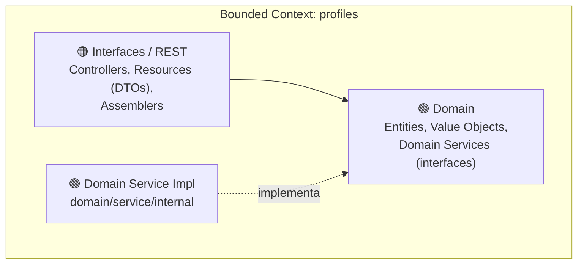
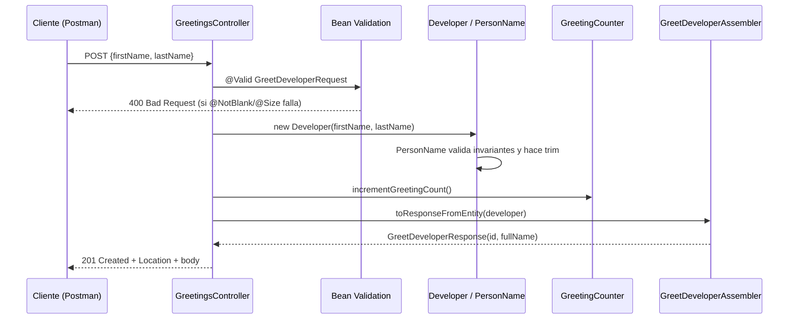
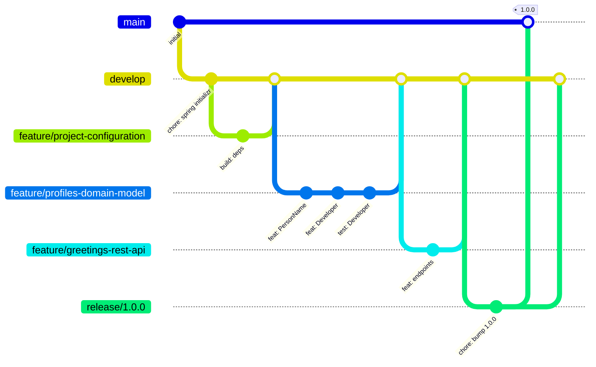
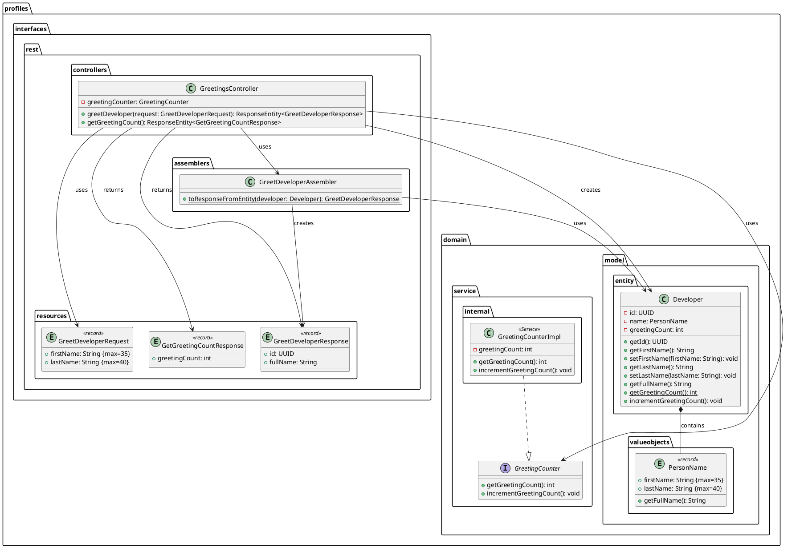

# 📘 Guía Completa de Desarrollo — Hello Spring Boot Developer

## API REST con Spring Boot 4, Java 26, Domain-Driven Design (DDD), GitFlow y Postman

---

> [!IMPORTANT]
> Esta guía construye **desde cero** la API REST `hello-spring-boot-developer`. Sigue un flujo **progresivo** usando **DDD con enfoque Inside-Out** (Domain → Interfaces/REST), **GitFlow** con ramas `feature/`, `release/` y `hotfix/`, **Conventional Commits**, **Semantic Versioning** y pruebas de API con **Postman**. Cada paso explica **QUÉ** genera la herramienta por defecto y **POR QUÉ** se modifica.
>
> El código de esta guía es el mismo del proyecto de referencia (`com.acme.hello.platform`). Las secciones marcadas como **(Opcional)** son mejoras que **no** están en el proyecto original.

---

## Tabla de Contenidos

| Fase | Pasos | Descripción |
|:-----|:------|:------------|
| **Fase 0** | 1–4 | Herramientas, creación del proyecto, repositorio GitFlow y dependencias |
| **Fase 1** | 5–7 | Profiles Bounded Context — Domain (Value Object, Entity, tests) |
| **Fase 2** | 8 | Profiles Bounded Context — Domain Service (`GreetingCounter`) |
| **Fase 3** | 9–12 | Profiles Bounded Context — Interfaces/REST (Resources, Assembler, Controller) |
| **Fase 4** | 13–14 | Ejecución, Swagger UI / OpenAPI |
| **Fase 5** | 15–18 | Pruebas de la API con Postman (colección, entorno, tests, Newman) |
| **Fase 6** | 19 | Documentación (Doc-as-Code) |
| **Fase 7** | 20–22 | Release con GitFlow, push a GitHub y ejemplo de hotfix |
| **Anexos** | — | Observaciones del código, mejoras opcionales, resumen de commits, referencias |

---

## Convenciones de la Guía

| Icono | Significado |
|:------|:------------|
| 💻 | Ejecutar comando en terminal |
| 📁 | Archivo o directorio creado |
| ✏️ | Editar / Reemplazar contenido |
| 🔀 | Realizar commit |
| 🌿 | Operación de rama (branch) |
| 💡 | Explicación de por qué se hace así |
| ⚙️ | Lo que Spring Initializr / la herramienta genera por defecto |
| 📮 | Paso en Postman |
| ⚠️ | Advertencia o buena práctica importante |

> [!NOTE]
> Los comandos se muestran para **Git Bash** (`./mvnw`). En **PowerShell** o **CMD** de Windows usa `.\mvnw.cmd` en lugar de `./mvnw`.

---

## Herramientas y Prerrequisitos

| Herramienta | Versión | Para qué se usa | Verificación |
|:-----------|:--------|:----------------|:-------------|
| JDK | **26** (Temurin, Corretto, Oracle…) | Compilar y ejecutar Java 26 | `java -version` |
| Maven | 3.9.x (vía **Maven Wrapper**, no necesitas instalarlo) | Build y dependencias | `./mvnw -v` |
| Git | 2.x+ | Control de versiones | `git --version` |
| Git Flow AVH | Incluido en Git for Windows | Flujo de ramas GitFlow | `git flow version` |
| IntelliJ IDEA | 2026.x (Community o Ultimate) | IDE para Java / Spring | — |
| Plugin **Lombok** | Incluido en IntelliJ | Reconoce `@Getter`, etc. | — |
| Plugin **PlantUML Integration** | Última | Ver `docs/class-diagram.puml` | — |
| **Postman** | Última (desktop) | Probar y documentar la API | — |
| Node.js *(opcional)* | 22+ | Ejecutar colecciones Postman con **Newman** | `node --version` |
| curl *(opcional)* | Incluido en Windows 10+ | Pruebas rápidas por terminal | `curl --version` |
| Cuenta GitHub | — | Repositorio remoto | — |

💡 **¿Por qué Java 26?** El proyecto usa características modernas:
- `UUID.ofEpochMillis(...)` para generar identificadores **UUID v7** (ordenados por tiempo).
- `static void main(String[] args)` sin `public` (métodos `main` de instancia/simplificados).
- Comentarios de documentación en **Markdown** con `///` (además del Javadoc clásico `/** */`).
- **Records** para Value Objects y DTOs.

> [!WARNING]
> Si tu JDK es menor a 26, el proyecto **no compila** (`UUID.ofEpochMillis` no existe). En IntelliJ puedes descargar el JDK desde **File → Project Structure → SDKs → + → Download JDK**.

---

## Sobre el Enfoque DDD en Backend

En DDD organizamos el código en **Bounded Contexts** (contextos delimitados). Este proyecto tiene uno: **`profiles`** (perfiles de desarrolladores). Cada contexto se divide en capas:



| Capa | Paquete | Contiene | Regla |
|:-----|:--------|:---------|:------|
| **Domain – Model** | `profiles.domain.model.entity` / `valueobjects` | `Developer`, `PersonName` | **No** depende de Spring ni de la capa REST. Aquí viven las **invariantes** del negocio |
| **Domain – Service** | `profiles.domain.service` (+ `internal`) | `GreetingCounter` (interfaz) y su implementación | El contrato es de dominio; la implementación es un detalle |
| **Interfaces – REST** | `profiles.interfaces.rest.*` | `GreetingsController`, `*Request`, `*Response`, `GreetDeveloperAssembler` | Traduce HTTP ↔ Dominio. **Sin lógica de negocio** |

**Regla de dependencias:** `Interfaces/REST → Domain`. El dominio **nunca** importa nada de `interfaces`.

**Flujo de una petición `POST /api/v1/greetings`:**



> [!NOTE]
> En proyectos más grandes cada bounded context suele tener también las capas **`application`** (Command/Query Services) e **`infrastructure`** (persistencia JPA, repositorios, clientes externos). Este proyecto es intencionalmente pequeño y no las necesita todavía (no hay base de datos). Ver [Anexo B](#anexo-b--mejoras-opcionales).

### ¿Por qué Inside-Out (de adentro hacia afuera)?

En tus guías de Angular se usó **Outside-In** porque el frontend nace de la UI. En backend conviene lo contrario:

1. El **dominio** no depende de nada → se puede escribir y **testear primero** con JUnit, sin levantar Spring.
2. La capa REST solo **traduce**; si el dominio ya está probado, el controller queda trivial.
3. Coincide con el historial real del proyecto (primero `Developer`/`PersonName`, después endpoints).

---

## Sobre GitFlow

| Rama | Sale de | Se fusiona en | Propósito |
|:-----|:--------|:--------------|:----------|
| `main` | — | — | Código en producción. Cada merge = una versión con **tag** |
| `develop` | `main` | — | Rama de integración. Todo el desarrollo parte de aquí |
| `feature/<nombre>` | `develop` | `develop` | Nuevas funcionalidades |
| `bugfix/<nombre>` | `develop` | `develop` | Corrección de bugs aún no liberados |
| `release/<versión>` | `develop` | `main` **y** `develop` | Preparar una versión (versión del pom, CHANGELOG) |
| `hotfix/<versión>` | `main` | `main` **y** `develop` | Arreglo urgente en producción |



### Conventional Commits

Formato: `<type>(<scope>): <description>`

| Tipo | Uso |
|:-----|:----|
| `feat` | Nueva funcionalidad |
| `fix` | Corrección de bug |
| `docs` | Solo documentación |
| `style` | Formato, espacios (sin cambiar lógica) |
| `refactor` | Cambio de código que no agrega feature ni corrige bug |
| `perf` | Mejora de rendimiento |
| `test` | Agregar o corregir tests |
| `build` | Sistema de build / dependencias (`pom.xml`) |
| `ci` | Configuración de CI |
| `chore` | Otras tareas (no tocan `src` ni `test`) |

Scopes usados en esta guía: `profiles`, `domain`, `api`, `postman`, `release`.

### Semantic Versioning

`MAJOR.MINOR.PATCH` → **MAJOR**: cambio incompatible de API · **MINOR**: funcionalidad compatible · **PATCH**: bugfix compatible.

---

# FASE 0 — Configuración del Proyecto

## Paso 1: Instalar y verificar las herramientas

💻 Verifica todo en una terminal (Git Bash):

```bash
java -version
git --version
git flow version
```

Debes ver `openjdk version "26..."` y `1.12.x (AVH Edition)` para git flow.

💻 Configura tu identidad de Git (si no lo hiciste antes):

```bash
git config --global user.name "Tu Nombre"
git config --global user.email "tu-correo@ejemplo.com"
```

📮 Instala **Postman** desde [postman.com/downloads](https://www.postman.com/downloads/) e inicia sesión (o usa el modo *Lightweight API Client* sin cuenta).

---

## Paso 2: Crear el proyecto con Spring Initializr

Tienes dos opciones equivalentes.

### Opción A — Web: [start.spring.io](https://start.spring.io)

| Campo | Valor |
|:------|:------|
| Project | **Maven** |
| Language | **Java** |
| Spring Boot | **4.1.0** |
| Group | `com.acme.hello.platform` |
| Artifact | `hello-spring-boot-developer` |
| Name | `hello-spring-boot-developer` |
| Description | `Hello Spring Boot Developer Application` |
| Package name | `com.acme.hello.platform` ⚠️ (edítalo, ver abajo) |
| Packaging | **Jar** |
| Configuration | **Properties** |
| Java | **26** |

**Dependencies** (botón *ADD DEPENDENCIES*):

| Dependencia | Para qué |
|:------------|:---------|
| **Spring Web** | API REST con Spring MVC + Tomcat embebido |
| **Validation** | Bean Validation (`@NotBlank`, `@Size`, `@Valid`) |
| **Spring Boot DevTools** | Reinicio automático al cambiar código |
| **Lombok** | Generar getters con `@Getter` |

Pulsa **GENERATE**, descomprime el `.zip` en tu carpeta de trabajo y ábrelo con IntelliJ (**File → Open** → carpeta del proyecto).

> [!WARNING]
> Initializr propone por defecto el paquete `com.acme.hello.platform.hello_spring_boot_developer`. Cámbialo a **`com.acme.hello.platform`** para que coincida con el proyecto de referencia.

### Opción B — IntelliJ IDEA

**File → New → Project → Spring Boot** y llena los mismos valores. En *Ultimate* está integrado; en *Community* usa la Opción A.

### Opción C — Terminal (curl)

💻
```bash
curl https://start.spring.io/starter.zip \
  -d type=maven-project -d language=java \
  -d bootVersion=4.1.0 -d javaVersion=26 \
  -d groupId=com.acme.hello.platform \
  -d artifactId=hello-spring-boot-developer \
  -d name=hello-spring-boot-developer \
  -d "description=Hello Spring Boot Developer Application" \
  -d packageName=com.acme.hello.platform \
  -d packaging=jar \
  -d dependencies=web,validation,devtools,lombok \
  -o hello-spring-boot-developer.zip
unzip hello-spring-boot-developer.zip -d hello-spring-boot-developer
cd hello-spring-boot-developer
```

⚙️ **Spring Initializr genera por defecto:**
```
hello-spring-boot-developer/
├── .mvn/wrapper/maven-wrapper.properties   ← Versión de Maven que descarga el wrapper
├── src/
│   ├── main/
│   │   ├── java/com/acme/hello/platform/
│   │   │   └── HelloSpringBootDeveloperApplication.java   ← Clase principal
│   │   └── resources/
│   │       ├── application.properties       ← Configuración
│   │       ├── static/                      ← (vacío, no se usa en una API)
│   │       └── templates/                   ← (vacío, no se usa en una API)
│   └── test/java/com/acme/hello/platform/
│       └── HelloSpringBootDeveloperApplicationTests.java  ← Test "contextLoads"
├── .gitattributes
├── .gitignore
├── HELP.md                                  ← Enlaces de ayuda (está en .gitignore)
├── mvnw / mvnw.cmd                          ← Maven Wrapper (Linux-Mac / Windows)
└── pom.xml
```

> [!NOTE]
> Con Spring Boot 4, Initializr puede generar `spring-boot-starter-webmvc` en vez de `spring-boot-starter-web` (y un starter de test adicional). Ambos sirven para una API REST con Spring MVC. Para quedar **idéntico** al proyecto de referencia usa `spring-boot-starter-web` (lo dejamos así en el Paso 4).

💡 Elimina las carpetas vacías que no usará una API REST:
```bash
rm -rf src/main/resources/static src/main/resources/templates
```

✏️ **`HelloSpringBootDeveloperApplication.java`** — Initializr genera `public static void main`. En Java 26 el método `main` puede declararse sin `public`; el proyecto de referencia lo deja así:

```java
package com.acme.hello.platform;

import org.springframework.boot.SpringApplication;
import org.springframework.boot.autoconfigure.SpringBootApplication;

@SpringBootApplication
public class HelloSpringBootDeveloperApplication {

    static void main(String[] args) {
        SpringApplication.run(HelloSpringBootDeveloperApplication.class, args);
    }

}
```

💡 `@SpringBootApplication` = `@Configuration` + `@EnableAutoConfiguration` + `@ComponentScan`. El **component scan** busca beans (`@RestController`, `@Service`…) en `com.acme.hello.platform` **y todos sus subpaquetes**; por eso todos los bounded contexts deben vivir debajo de ese paquete.

💻 Verifica que compile y pase el test inicial:
```bash
./mvnw clean test
```

---

## Paso 3: Configuración inicial del repositorio con GitFlow

💻 Inicializa GitFlow aceptando los valores por defecto (`-d`). Si la carpeta aún no es repositorio Git, `git flow init` ejecuta `git init` por ti:

```bash
git flow init -d
```

⚙️ **`git flow init -d` configura:**
| Ajuste | Valor |
|:-------|:------|
| Rama de producción | `main` |
| Rama de desarrollo | `develop` (se crea y queda activa) |
| Prefijos | `feature/`, `bugfix/`, `release/`, `hotfix/`, `support/` |
| Prefijo de tags | *(vacío)* → tags como `1.0.0` |

> Si tu Git crea `master` en lugar de `main`, ejecuta antes `git config --global init.defaultBranch main`, o usa `git flow init` sin `-d` y escribe `main` cuando pregunte.

✏️ Revisa **`.gitignore`** (Initializr ya lo genera). Debe contener al menos:

```gitignore
HELP.md
target/
.mvn/wrapper/maven-wrapper.jar
!**/src/main/**/target/
!**/src/test/**/target/

### STS ###
.apt_generated
.classpath
.factorypath
.project
.settings
.springBeans
.sts4-cache

### IntelliJ IDEA ###
.idea
*.iws
*.iml
*.ipr

### NetBeans ###
/nbproject/private/
/nbbuild/
/dist/
/nbdist/
/.nb-gradle/
build/
!**/src/main/**/build/
!**/src/test/**/build/

### VS Code ###
.vscode/
```

✏️ Revisa **`.gitattributes`**:

```gitattributes
/mvnw text eol=lf
*.cmd text eol=crlf
```

💡 `mvnw` es un script de shell: si se guarda con fin de línea Windows (CRLF) falla en Linux/Mac/CI con `/bin/sh^M: bad interpreter`. Este archivo fuerza LF para `mvnw` y CRLF para `mvnw.cmd`.

> [!TIP]
> Si `.idea/` llegó a commitearse alguna vez: `git rm -r --cached .idea`

🔀 **Commit en `develop`:**
```bash
git add .
git commit -m "chore: initial project setup with spring initializr"
```

---

## Paso 4: Configurar dependencias y metadatos del proyecto (`pom.xml`)

🌿 Crea una rama feature:
```bash
git flow feature start project-configuration
```

✏️ Reemplaza **`pom.xml`** completo:

```xml
<?xml version="1.0" encoding="UTF-8"?>
<project xmlns="http://maven.apache.org/POM/4.0.0" xmlns:xsi="http://www.w3.org/2001/XMLSchema-instance"
         xsi:schemaLocation="http://maven.apache.org/POM/4.0.0 https://maven.apache.org/xsd/maven-4.0.0.xsd">
    <modelVersion>4.0.0</modelVersion>
    <!-- El parent gestiona las versiones de todas las dependencias de Spring, Lombok, JUnit, etc. -->
    <parent>
        <groupId>org.springframework.boot</groupId>
        <artifactId>spring-boot-starter-parent</artifactId>
        <version>4.1.0</version>
        <relativePath/> <!-- lookup parent from a repository -->
    </parent>
    <groupId>com.acme.hello.platform</groupId>
    <artifactId>hello-spring-boot-developer</artifactId>
    <!-- Versión en desarrollo; se fija a la versión final en la rama release/ (Paso 20) -->
    <version>0.0.1-SNAPSHOT</version>
    <name>hello-spring-boot-developer</name>
    <description>Hello Spring Boot Developer Application</description>
    <licenses>
        <license>
            <name>MIT License</name>
            <url>https://opensource.org/licenses/MIT</url>
            <distribution>repo</distribution>
        </license>
    </licenses>
    <developers>
        <developer>
            <id>acme-team</id>
            <name>Open-Source Application Development Team</name>
            <organization>Acme</organization>
            <organizationUrl>https://acme.com</organizationUrl>
        </developer>
    </developers>
    <!-- Versiones centralizadas: se cambian en un solo lugar -->
    <properties>
        <java.version>26</java.version>
        <commons-lang3.version>3.20.0</commons-lang3.version>
        <spring-doc.version>2.8.5</spring-doc.version>
    </properties>
    <dependencies>
        <!-- Bean Validation: @NotBlank, @Size, @Valid -->
        <dependency>
            <groupId>org.springframework.boot</groupId>
            <artifactId>spring-boot-starter-validation</artifactId>
        </dependency>
        <!-- Spring MVC + Jackson + Tomcat embebido -->
        <dependency>
            <groupId>org.springframework.boot</groupId>
            <artifactId>spring-boot-starter-web</artifactId>
        </dependency>

        <!-- Reinicio automático en desarrollo; no se empaqueta en producción -->
        <dependency>
            <groupId>org.springframework.boot</groupId>
            <artifactId>spring-boot-devtools</artifactId>
            <scope>runtime</scope>
            <optional>true</optional>
        </dependency>
        <!-- StringUtils.isBlank(...) usado por el Value Object PersonName -->
        <dependency>
            <groupId>org.apache.commons</groupId>
            <artifactId>commons-lang3</artifactId>
            <version>${commons-lang3.version}</version>
        </dependency>
        <!-- Genera getters en tiempo de compilación -->
        <dependency>
            <groupId>org.projectlombok</groupId>
            <artifactId>lombok</artifactId>
            <optional>true</optional>
        </dependency>
        <!-- OpenAPI 3 + Swagger UI generados a partir de los controllers -->
        <dependency>
            <groupId>org.springdoc</groupId>
            <artifactId>springdoc-openapi-starter-webmvc-ui</artifactId>
            <version>${spring-doc.version}</version>
        </dependency>
        <!-- JUnit 5, AssertJ, Mockito, Spring Test -->
        <dependency>
            <groupId>org.springframework.boot</groupId>
            <artifactId>spring-boot-starter-test</artifactId>
            <scope>test</scope>
        </dependency>
    </dependencies>

    <build>
        <plugins>
            <plugin>
                <groupId>org.apache.maven.plugins</groupId>
                <artifactId>maven-compiler-plugin</artifactId>
                <configuration>
                    <!-- Lombok es un annotation processor: hay que declararlo explícitamente -->
                    <annotationProcessorPaths>
                        <path>
                            <groupId>org.projectlombok</groupId>
                            <artifactId>lombok</artifactId>
                        </path>
                    </annotationProcessorPaths>
                </configuration>
            </plugin>
            <plugin>
                <groupId>org.springframework.boot</groupId>
                <artifactId>spring-boot-maven-plugin</artifactId>
                <configuration>
                    <!-- Lombok solo se necesita al compilar: se excluye del JAR ejecutable -->
                    <excludes>
                        <exclude>
                            <groupId>org.projectlombok</groupId>
                            <artifactId>lombok</artifactId>
                        </exclude>
                    </excludes>
                </configuration>
            </plugin>
        </plugins>
    </build>

</project>
```

💡 **¿Qué cambió respecto a lo generado?**
| Cambio | Motivo |
|:-------|:-------|
| `<licenses>` y `<developers>` | Metadatos del proyecto (licencia MIT) |
| `<properties>` con versiones | Centralizar versiones de librerías que **no** gestiona el parent de Spring Boot |
| `commons-lang3` | `StringUtils.isBlank()` maneja `null`, `""` y `"   "` en una sola llamada |
| `springdoc-openapi-starter-webmvc-ui` | Documentación interactiva en `/swagger-ui.html` |
| `spring-boot-starter-web` | Igual que el proyecto de referencia |

> [!WARNING]
> **Compatibilidad de springdoc:** la línea **2.x** de springdoc está pensada para Spring Boot 3. Si al ejecutar (Paso 13) Swagger UI no carga o aparece un error de arranque relacionado con `springdoc`, cambia la propiedad a la línea **3.x** (compatible con Spring Boot 4), por ejemplo `<spring-doc.version>3.0.0</spring-doc.version>`, y vuelve a ejecutar.

✏️ **`src/main/resources/application.properties`**:

```properties
spring.application.name=hello-spring-boot-developer
```

💡 Es lo único que necesita: puerto `8080` por defecto y sin base de datos. Si el puerto está ocupado puedes agregar `server.port=8081`.

⚙️ **Lombok en IntelliJ:** verifica **Settings → Build, Execution, Deployment → Compiler → Annotation Processors → Enable annotation processing**. Sin eso el IDE marca en rojo los getters generados (aunque Maven compile bien).

💻 Recarga Maven en IntelliJ (ícono 🔄 *Load Maven Changes*) y verifica:
```bash
./mvnw clean test
```

🔀 **Commits:**
```bash
git add pom.xml
git commit -m "build: add validation, commons-lang3, lombok and springdoc dependencies"
git add src/main/resources/application.properties
git commit -m "chore: configure application properties"
```

🌿 Cierra la feature (fusiona en `develop` y borra la rama):
```bash
git flow feature finish project-configuration
```

---

# FASE 1 — Profiles Bounded Context: Domain Layer

> [!IMPORTANT]
> El **dominio** contiene las reglas del negocio. Aquí no hay anotaciones de Spring ni HTTP. Las invariantes (nombres no vacíos, longitudes máximas) se validan **dentro** del modelo, de modo que **es imposible** crear un `Developer` inválido aunque alguien se salte la capa REST.

🌿 Crea la rama:
```bash
git flow feature start profiles-domain-model
```

📁 Crea la estructura de paquetes (en IntelliJ: clic derecho sobre `com.acme.hello.platform` → **New → Package**):
```
src/main/java/com/acme/hello/platform/profiles/domain/model/entity/
src/main/java/com/acme/hello/platform/profiles/domain/model/valueobjects/
```

---

## Paso 5: Crear el Value Object `PersonName`

💡 **Entity vs Value Object**
| | Entity | Value Object |
|:--|:-------|:-------------|
| Identidad | Tiene ID propio (`Developer.id`) | No tiene ID; se define por sus atributos |
| Igualdad | Dos entidades son iguales si tienen el mismo ID | Dos VO son iguales si **todos** sus valores son iguales |
| Mutabilidad | Puede cambiar de estado | **Inmutable** → se reemplaza por otro |
| En Java | `class` | `record` (inmutable, `equals`/`hashCode` automáticos) |

📁 **`profiles/domain/model/valueobjects/PersonName.java`** (IntelliJ: **New → Java Class → Record**):

```java
package com.acme.hello.platform.profiles.domain.model.valueobjects;

import org.apache.commons.lang3.StringUtils;

/**
 * Value object representing a person's name.
 * Encapsulates validation logic and formatting for first and last names.
 *
 * @param firstName The first name.
 * @param lastName  The last name.
 */
public record PersonName(String firstName, String lastName) {
    private static final int FIRST_NAME_MAX_LENGTH = 35;
    private static final int LAST_NAME_MAX_LENGTH = 40;

    public PersonName {
        if (StringUtils.isBlank(firstName)) {
            throw new IllegalArgumentException("First name cannot be blank");
        }
        if (firstName.length() > FIRST_NAME_MAX_LENGTH) {
            throw new IllegalArgumentException("First name must be at most " + FIRST_NAME_MAX_LENGTH + " characters");
        }
        if (StringUtils.isBlank(lastName)) {
            throw new IllegalArgumentException("Last name cannot be blank");
        }
        if (lastName.length() > LAST_NAME_MAX_LENGTH) {
            throw new IllegalArgumentException("Last name must be at most " + LAST_NAME_MAX_LENGTH + " characters");
        }
        firstName = firstName.trim();
        lastName = lastName.trim();
    }

    /**
     * Returns the full name by combining first and last names.
     *
     * @return The full name.
     */
    public String getFullName() {
        return String.format("%s %s", firstName, lastName);
    }
}
```

💡 **Puntos clave:**
- `public PersonName { ... }` es un **constructor compacto** de record: corre **antes** de asignar los campos, por eso puede validar y también **reasignar** `firstName = firstName.trim()`.
- `StringUtils.isBlank()` devuelve `true` para `null`, `""` y `"   "`: un solo chequeo cubre los tres casos (escenario TS02-4).
- Las constantes `35` y `40` son las **invariantes** del dominio (escenario TS02-3).
- El `trim()` implementa el escenario TS02-2 (*Whitespace Handling*).

---

## Paso 6: Crear la Entity `Developer`

📁 **`profiles/domain/model/entity/Developer.java`**:

```java
package com.acme.hello.platform.profiles.domain.model.entity;

import com.acme.hello.platform.profiles.domain.model.valueobjects.PersonName;
import lombok.Getter;

import java.util.UUID;

/**
 * Represents a Developer entity.
 * <p>
 * This entity represents a developer in the system, with a unique identifier and basic profile information.
 * It also tracks the number of times the developer has been greeted.
 * </p>
 * <p>
 * The identifier is a time-ordered UUID v7.
 * </p>
 *
 * @author Open-Source Application Development Team
 * @version 1.0.0
 */
@Getter
public class Developer {
    /**
     * The unique identifier of the developer.
     * Uses UUID v7 for time-ordered, lexicographically sortable identifiers.
     */
    private final UUID id;

    /**
     * The developer's name.
     */
    private PersonName name;

    /**
     * The number of times this developer has been greeted.
     */
    @Getter
    private static int greetingCount = 0;

    /**
     * Constructs a new Developer with the given first and last names.
     * Initializes the greeting count to zero and generates a time-ordered UUID v7.
     *
     * @param firstName the developer's first name
     * @param lastName  the developer's last name
     * @throws IllegalArgumentException if either name is blank or exceeds the maximum length
     */
    public Developer(String firstName, String lastName) {
        this.id = UUID.ofEpochMillis(System.currentTimeMillis());
        this.name = new PersonName(firstName, lastName);
    }

    /**
     * Updates the developer's first name.
     *
     * @param firstName the new first name
     * @throws IllegalArgumentException if the first name is blank or exceeds the maximum length
     */
    public void setFirstName(String firstName) {
        this.name = new PersonName(firstName, this.name.lastName());
    }

    /**
     * Updates the developer's last name.
     *
     * @param lastName the new last name
     * @throws IllegalArgumentException if the last name is blank or exceeds the maximum length
     */
    public void setLastName(String lastName) {
        this.name = new PersonName(this.name.firstName(), lastName);
    }

    /**
     * Returns the developer's first name.
     *
     * @return the first name
     */
    public String getFirstName() {
        return name.firstName();
    }

    /**
     * Returns the developer's last name.
     *
     * @return the last name
     */
    public String getLastName() {
        return name.lastName();
    }

    /**
     * Returns the full name of the developer.
     *
     * @return the combined first and last names
     */
    public String getFullName() {
        return name.getFullName();
    }

    /**
     * Increments the greeting counter for this developer.
     */
    public void incrementGreetingCount() {
        Developer.greetingCount++;
    }
}
```

💡 **Puntos clave:**
- `@Getter` (Lombok) en la clase genera `getId()` y `getName()`. El `@Getter` sobre el campo `static` genera `Developer.getGreetingCount()` (estático).
- **No hay `setName()` ni `setId()`**: el `id` es `final` y el nombre solo cambia mediante `setFirstName`/`setLastName`, que **crean un nuevo `PersonName`** → las invariantes se vuelven a validar siempre.
- `UUID.ofEpochMillis(...)` (Java 26) genera un **UUID versión 7**: los primeros 48 bits son el timestamp, por lo que los IDs quedan **ordenados por fecha de creación** (ideal como clave primaria en BD).
- `getFirstName()`, `getLastName()`, `getFullName()` **delegan** en el Value Object (Ley de Demeter: el resto del código no necesita saber que existe `PersonName`).

> [!NOTE]
> El contador `static greetingCount` de la entidad viene del proyecto original (versión 1.1.0). Desde la Fase 2 el contador "oficial" que usa la API es el servicio `GreetingCounter`. Ver [Anexo A](#anexo-a--observaciones-sobre-el-código-de-referencia).

🔀 **Commits:**
```bash
git add src/main/java/com/acme/hello/platform/profiles/domain/model/valueobjects
git commit -m "feat(profiles): add person name value object with name invariants"
git add src/main/java/com/acme/hello/platform/profiles/domain/model/entity
git commit -m "feat(profiles): add developer entity with uuid v7 identifier"
```

---

## Paso 7: Tests unitarios del dominio

📁 Crea el paquete de test espejo:
```
src/test/java/com/acme/hello/platform/profiles/domain/model/entity/
```

💡 IntelliJ: con el cursor en la clase `Developer` pulsa **Ctrl+Shift+T → Create New Test…** (JUnit 5). Se crea en el paquete correcto automáticamente.

📁 **`DeveloperTest.java`**:

```java
package com.acme.hello.platform.profiles.domain.model.entity;

import org.junit.jupiter.api.DisplayName;
import org.junit.jupiter.api.Test;

import static org.assertj.core.api.Assertions.assertThat;
import static org.assertj.core.api.Assertions.assertThatThrownBy;

@DisplayName("Developer Entity Tests")
class DeveloperTest {

    @Test
    @DisplayName("Constructor should initialize developer with correct values and UUID v7")
    void constructorShouldInitializeDeveloperCorrectly() {
        // Arrange
        String firstName = "John";
        String lastName = "Doe";
        int initialGreetingCount = Developer.getGreetingCount();

        // Act
        Developer developer = new Developer(firstName, lastName);

        // Assert
        assertThat(developer.getId()).isNotNull();
        assertThat(developer.getId().version()).isEqualTo(7);
        assertThat(developer.getFirstName()).isEqualTo(firstName);
        assertThat(developer.getLastName()).isEqualTo(lastName);
        assertThat(Developer.getGreetingCount()).isEqualTo(initialGreetingCount);
    }

    @Test
    @DisplayName("Constructor should throw exception when first name is blank")
    void constructorShouldThrowExceptionWhenFirstNameIsBlank() {
        assertThatThrownBy(() -> new Developer("", "Doe"))
                .isInstanceOf(IllegalArgumentException.class)
                .hasMessage("First name cannot be blank");

        assertThatThrownBy(() -> new Developer("   ", "Doe"))
                .isInstanceOf(IllegalArgumentException.class)
                .hasMessage("First name cannot be blank");

        assertThatThrownBy(() -> new Developer(null, "Doe"))
                .isInstanceOf(IllegalArgumentException.class)
                .hasMessage("First name cannot be blank");
    }

    @Test
    @DisplayName("Constructor should throw exception when last name is blank")
    void constructorShouldThrowExceptionWhenLastNameIsBlank() {
        assertThatThrownBy(() -> new Developer("John", ""))
                .isInstanceOf(IllegalArgumentException.class)
                .hasMessage("Last name cannot be blank");

        assertThatThrownBy(() -> new Developer("John", "   "))
                .isInstanceOf(IllegalArgumentException.class)
                .hasMessage("Last name cannot be blank");

        assertThatThrownBy(() -> new Developer("John", null))
                .isInstanceOf(IllegalArgumentException.class)
                .hasMessage("Last name cannot be blank");
    }

    @Test
    @DisplayName("setFirstName should update first name and trim it")
    void setFirstNameShouldUpdateAndTrim() {
        // Arrange
        Developer developer = new Developer("John", "Doe");

        // Act
        developer.setFirstName("  Jane  ");

        // Assert
        assertThat(developer.getFirstName()).isEqualTo("Jane");
    }

    @Test
    @DisplayName("setLastName should update last name and trim it")
    void setLastNameShouldUpdateAndTrim() {
        // Arrange
        Developer developer = new Developer("John", "Doe");

        // Act
        developer.setLastName("  Smith  ");

        // Assert
        assertThat(developer.getLastName()).isEqualTo("Smith");
    }

    @Test
    @DisplayName("getFullName should return combined names")
    void getFullNameShouldReturnCombinedNames() {
        // Arrange
        Developer developer = new Developer("John", "Doe");

        // Act & Assert
        assertThat(developer.getFullName()).isEqualTo("John Doe");
    }

    @Test
    @DisplayName("incrementGreetingCount should increase the counter")
    void incrementGreetingCountShouldIncreaseCounter() {
        // Arrange
        Developer developer = new Developer("John", "Doe");
        int initialGreetingCount = Developer.getGreetingCount();

        // Act
        developer.incrementGreetingCount();
        developer.incrementGreetingCount();

        // Assert
        assertThat(Developer.getGreetingCount()).isEqualTo(initialGreetingCount + 2);
    }

    @Test
    @DisplayName("Constructor should throw exception when first name exceeds maximum length")
    void constructorShouldThrowExceptionWhenFirstNameExceedsMaxLength() {
        String longFirstName = "A".repeat(36);
        assertThatThrownBy(() -> new Developer(longFirstName, "Doe"))
                .isInstanceOf(IllegalArgumentException.class)
                .hasMessage("First name must be at most 35 characters");
    }

    @Test
    @DisplayName("Constructor should throw exception when last name exceeds maximum length")
    void constructorShouldThrowExceptionWhenLastNameExceedsMaxLength() {
        String longLastName = "A".repeat(41);
        assertThatThrownBy(() -> new Developer("John", longLastName))
                .isInstanceOf(IllegalArgumentException.class)
                .hasMessage("Last name must be at most 40 characters");
    }

    @Test
    @DisplayName("setFirstName should throw exception when first name exceeds maximum length")
    void setFirstNameShouldThrowExceptionWhenExceedsMaxLength() {
        Developer developer = new Developer("John", "Doe");
        String longFirstName = "A".repeat(36);
        assertThatThrownBy(() -> developer.setFirstName(longFirstName))
                .isInstanceOf(IllegalArgumentException.class)
                .hasMessage("First name must be at most 35 characters");
    }

    @Test
    @DisplayName("setLastName should throw exception when last name exceeds maximum length")
    void setLastNameShouldThrowExceptionWhenExceedsMaxLength() {
        Developer developer = new Developer("John", "Doe");
        String longLastName = "A".repeat(41);
        assertThatThrownBy(() -> developer.setLastName(longLastName))
                .isInstanceOf(IllegalArgumentException.class)
                .hasMessage("Last name must be at most 40 characters");
    }
}
```

📁 **`DeveloperUuidTest.java`**:

```java
package com.acme.hello.platform.profiles.domain.model.entity;

import org.junit.jupiter.api.DisplayName;
import org.junit.jupiter.api.Test;

import static org.assertj.core.api.Assertions.assertThat;

@DisplayName("Developer UUID Tests")
class DeveloperUuidTest {

    @Test
    @DisplayName("Newly created Developer should have a UUID v7")
    void newlyCreatedDeveloperShouldHaveUuidV7() {
        // Act
        Developer developer = new Developer("John", "Doe");

        // Assert
        assertThat(developer.getId()).isNotNull();
        assertThat(developer.getId().version()).isEqualTo(7);
    }
}
```

💡 **Patrón AAA** (Arrange–Act–Assert) y **AssertJ** (`assertThat`, `assertThatThrownBy`) vienen incluidos en `spring-boot-starter-test`. Estos tests **no levantan Spring** (no tienen `@SpringBootTest`): corren en milisegundos. Esa es la ventaja de un dominio sin dependencias.

⚠️ Como `greetingCount` es `static`, su valor se **comparte entre tests**. Por eso los tests guardan `initialGreetingCount` y comparan contra `initial + 2` en lugar de un valor fijo (fue el bug "state accumulation" corregido en la versión 1.1.0 del proyecto original).

💻 Ejecuta solo los tests del dominio y luego todos:
```bash
./mvnw test -Dtest="Developer*Test"
./mvnw test
```

🔀 **Commit:**
```bash
git add src/test
git commit -m "test(profiles): add unit tests for developer entity and person name invariants"
```

🌿
```bash
git flow feature finish profiles-domain-model
```

---

# FASE 2 — Profiles Bounded Context: Domain Service

## Paso 8: Crear el servicio de dominio `GreetingCounter`

💡 **¿Por qué un servicio?** Contar saludos no es responsabilidad de **un** `Developer` concreto: es un dato del sistema. En DDD, la lógica que no pertenece naturalmente a una entidad va en un **Domain Service**. Se define una **interfaz** en el dominio y su implementación en `internal/`; el controller depende **solo de la interfaz** (Principio de Inversión de Dependencias), y Spring inyecta la implementación.

🌿
```bash
git flow feature start greeting-counter-service
```

📁 **`profiles/domain/service/GreetingCounter.java`**:

```java
package com.acme.hello.platform.profiles.domain.service;

public interface GreetingCounter {
    int getGreetingCount();
    void incrementGreetingCount();
}
```

📁 **`profiles/domain/service/internal/GreetingCounterImpl.java`**:

```java
package com.acme.hello.platform.profiles.domain.service.internal;

import com.acme.hello.platform.profiles.domain.service.GreetingCounter;
import org.springframework.stereotype.Service;

@Service
public class GreetingCounterImpl implements GreetingCounter {
    private int greetingCount = 0;

    @Override
    public int getGreetingCount() {
        return greetingCount;
    }

    @Override
    public void incrementGreetingCount() {
        greetingCount++;
    }
}
```

💡 `@Service` registra la clase como **bean singleton**: hay **una sola instancia** para toda la aplicación, por eso el contador acumula entre peticiones. El valor vive en memoria → **se reinicia a 0 cada vez que se reinicia la app** (y con DevTools, cada vez que guardas un cambio).

> [!WARNING]
> `int greetingCount++` **no es thread-safe**: Tomcat atiende peticiones en paralelo y dos `POST` simultáneos pueden perder un incremento. Lo corregimos como ejemplo de **hotfix** en el [Paso 22](#paso-22-ejemplo-de-hotfix-contador-thread-safe).

🔀 **Commit:**
```bash
git add src/main/java/com/acme/hello/platform/profiles/domain/service
git commit -m "feat(profiles): add greeting counter domain service"
```

🌿
```bash
git flow feature finish greeting-counter-service
```

---

# FASE 3 — Profiles Bounded Context: Interfaces / REST Layer

> [!IMPORTANT]
> Esta capa es el **adaptador HTTP**. Recibe JSON, lo convierte en objetos de dominio, invoca al dominio y devuelve JSON. **Nunca** se expone una entidad de dominio directamente en la API: se usan **Resources** (DTOs) y un **Assembler** que traduce entre ambos.

🌿
```bash
git flow feature start greetings-rest-api
```

📁 Estructura:
```
profiles/interfaces/rest/resources/
profiles/interfaces/rest/assemblers/
profiles/interfaces/rest/controllers/
```

---

## Paso 9: Crear los Resources (DTOs)

💡 Los **resources** son el **contrato público** de la API. Se usan `record` porque son inmutables y Jackson los serializa/deserializa automáticamente (por nombre de componente).

📁 **`resources/GreetDeveloperRequest.java`** — lo que el cliente envía:

```java
package com.acme.hello.platform.profiles.interfaces.rest.resources;

import jakarta.validation.constraints.NotBlank;
import jakarta.validation.constraints.Size;

/**
 * Request to greet a developer.
 */
public record GreetDeveloperRequest(
        @NotBlank(message = "First name cannot be blank")
        @Size(max = 35, message = "First name cannot exceed 35 characters") String firstName,
        @NotBlank(message = "Last name cannot be blank")
        @Size(max = 40, message = "Last name cannot exceed 40 characters") String lastName) {
}
```

📁 **`resources/GreetDeveloperResponse.java`** — lo que devuelve el `POST`:

```java
package com.acme.hello.platform.profiles.interfaces.rest.resources;

import java.util.UUID;

/**
 * Response to a greet developer request.
 */
public record GreetDeveloperResponse(UUID id, String fullName) {
}
```

📁 **`resources/GetGreetingCountResponse.java`** — lo que devuelve el `GET`:

```java
package com.acme.hello.platform.profiles.interfaces.rest.resources;

/// A response for getting the total number of greetings.
/// @param greetingCount the greeting count since service start
public record GetGreetingCountResponse(int greetingCount) {}
```

💡 **¿Validación duplicada?** Sí, a propósito (**defensa en profundidad**):
| Dónde | Qué hace | Si falla |
|:------|:---------|:---------|
| `GreetDeveloperRequest` (`@NotBlank`, `@Size`) | Rechaza la entrada **antes** de tocar el dominio | `400 Bad Request` automático |
| `PersonName` (constructor) | Garantiza que el dominio **nunca** quede inválido, venga de donde venga | `IllegalArgumentException` |

💡 `///` es la sintaxis de **comentarios de documentación en Markdown** (Java 23+); es equivalente a `/** */`.

🔀
```bash
git add src/main/java/com/acme/hello/platform/profiles/interfaces/rest/resources
git commit -m "feat(api): add greeting request and response resources"
```

---

## Paso 10: Crear el `GreetDeveloperAssembler`

📁 **`assemblers/GreetDeveloperAssembler.java`**:

```java
package com.acme.hello.platform.profiles.interfaces.rest.assemblers;

import com.acme.hello.platform.profiles.domain.model.entity.Developer;
import com.acme.hello.platform.profiles.interfaces.rest.resources.GreetDeveloperResponse;

/**
 * Assembler for greeting developer resources.
 */
public class GreetDeveloperAssembler {

    /**
     * Converts a Developer entity to a GreetDeveloperResponse.
     *
     * @param entity the developer entity
     * @return the greet-developer response
     */
    public static GreetDeveloperResponse toResponseFromEntity(Developer entity) {
        return new GreetDeveloperResponse(entity.getId(), entity.getFullName());
    }
}
```

💡 El **Assembler** es el "traductor" Entidad → Resource. Mantiene al controller limpio y concentra en un solo lugar la decisión de **qué** datos del dominio se exponen (aquí: `id` y `fullName`, pero no `firstName`/`lastName` por separado). Es estático porque no tiene estado ni dependencias.

🔀
```bash
git add src/main/java/com/acme/hello/platform/profiles/interfaces/rest/assemblers
git commit -m "feat(api): add greet developer assembler"
```

---

## Paso 11: Crear el `GreetingsController`

📁 **`controllers/GreetingsController.java`**:

```java
package com.acme.hello.platform.profiles.interfaces.rest.controllers;

import com.acme.hello.platform.profiles.domain.model.entity.Developer;
import com.acme.hello.platform.profiles.domain.service.GreetingCounter;
import com.acme.hello.platform.profiles.interfaces.rest.assemblers.GreetDeveloperAssembler;
import com.acme.hello.platform.profiles.interfaces.rest.resources.GetGreetingCountResponse;
import com.acme.hello.platform.profiles.interfaces.rest.resources.GreetDeveloperRequest;
import com.acme.hello.platform.profiles.interfaces.rest.resources.GreetDeveloperResponse;
import io.swagger.v3.oas.annotations.tags.Tag;
import jakarta.validation.Valid;
import org.springframework.http.ResponseEntity;
import org.springframework.web.bind.annotation.*;

import java.net.URI;

/**
 * Controller for greeting developers.
 */
@RestController
@RequestMapping("/api/v1/greetings")
@Tag(name = "Greetings", description = "Endpoints for greeting developers and tracking statistics")
public class GreetingsController {
    private final GreetingCounter greetingCounter;

    /// Creates a new GreetingsController with the specified GreetingCounter.
    /// @param greetingCounter the service instance for greeting counting
    public GreetingsController(GreetingCounter greetingCounter) {
        this.greetingCounter = greetingCounter;
    }

    /**
     * Greets a developer.
     *
     * @param request the developer-to-greet request
     * @return the greeted developer response
     */
    @PostMapping
    public ResponseEntity<GreetDeveloperResponse> greetDeveloper(@Valid @RequestBody GreetDeveloperRequest request) {
        var developer = new Developer(request.firstName(), request.lastName());
        greetingCounter.incrementGreetingCount();
        var response = GreetDeveloperAssembler.toResponseFromEntity(developer);
        return ResponseEntity.created(URI.create("/api/v1/greetings/" + developer.getId())).body(response);
    }

    /**
     * Gets the total number of greetings.
     *
     * @return the total number of greetings
     */
    @GetMapping
    public ResponseEntity<GetGreetingCountResponse> getGreetingCount() {
        var response = new GetGreetingCountResponse(greetingCounter.getGreetingCount());
        return ResponseEntity.ok(response);
    }
}
```

💡 **Línea por línea:**
| Elemento | Qué hace |
|:---------|:---------|
| `@RestController` | `@Controller` + `@ResponseBody`: lo que retorna cada método se serializa a JSON |
| `@RequestMapping("/api/v1/greetings")` | Ruta base. `v1` = **versionado de la API** en la URL |
| `@Tag(...)` | Agrupa los endpoints en Swagger UI |
| Constructor con `GreetingCounter` | **Inyección por constructor** (recomendada): no necesita `@Autowired` si hay un solo constructor; el campo puede ser `final` |
| `@Valid @RequestBody` | Deserializa el JSON y ejecuta Bean Validation. Si falla → `400` y el método **no se ejecuta** |
| `ResponseEntity.created(uri)` | Responde **`201 Created`** + cabecera `Location` (convención REST para creación) |
| `ResponseEntity.ok(...)` | Responde **`200 OK`** |

**Contrato de la API:**

| Método | Ruta | Body | Éxito | Error |
|:-------|:-----|:-----|:------|:------|
| `GET` | `/api/v1/greetings` | — | `200` `{"greetingCount": 2}` | — |
| `POST` | `/api/v1/greetings` | `{"firstName":"John","lastName":"Doe"}` | `201` `{"id":"<uuid-v7>","fullName":"John Doe"}` + `Location` | `400` si nombres vacíos o largos |

🔀
```bash
git add src/main/java/com/acme/hello/platform/profiles/interfaces/rest/controllers
git commit -m "feat(api): add greetings controller with create greeting and count endpoints"
```

---

## Paso 12: Verificar compilación y cerrar la feature

💻
```bash
./mvnw clean test
```

Debes ver algo como `Tests run: 12, Failures: 0, Errors: 0` y `BUILD SUCCESS` (11 tests de dominio + `contextLoads`, que levanta todo el contexto de Spring y verifica que los beans se inyectan bien).

🌿
```bash
git flow feature finish greetings-rest-api
```

---

# FASE 4 — Ejecución y Documentación OpenAPI

## Paso 13: Ejecutar la aplicación

💻 Desde terminal:
```bash
./mvnw spring-boot:run
```

O en IntelliJ: abre `HelloSpringBootDeveloperApplication` y pulsa ▶️ junto a la clase.

Al final del log debe aparecer:
```
Tomcat started on port 8080 (http) with context path '/'
Started HelloSpringBootDeveloperApplication in X.XXX seconds
```

💻 Prueba rápida con curl (Git Bash):
```bash
curl -i http://localhost:8080/api/v1/greetings
curl -i -X POST http://localhost:8080/api/v1/greetings \
     -H "Content-Type: application/json" \
     -d '{"firstName": "John", "lastName": "Doe"}'
```

> [!TIP]
> En PowerShell usa `curl.exe` (no el alias `curl` de PowerShell) o `Invoke-RestMethod`.

💡 **DevTools:** con la app corriendo, cada vez que **compilas** (IntelliJ: **Build → Build Project**, `Ctrl+F9`) la app se reinicia sola. Recuerda que el contador vuelve a 0 en cada reinicio.

---

## Paso 14: Swagger UI y especificación OpenAPI

Con la app corriendo abre:

| Recurso | URL |
|:--------|:----|
| Swagger UI (interactivo) | [http://localhost:8080/swagger-ui.html](http://localhost:8080/swagger-ui.html) |
| Especificación OpenAPI (JSON) | [http://localhost:8080/v3/api-docs](http://localhost:8080/v3/api-docs) |

💡 springdoc **lee tus controllers** (rutas, `@RequestBody`, records, `@NotBlank`, `@Size`, `@Tag`) y genera la documentación automáticamente. Las restricciones de validación aparecen en el esquema (`maxLength: 35`, etc.).

En Swagger UI: despliega **Greetings → POST /api/v1/greetings → Try it out → Execute**.

> [!NOTE]
> La URL `/v3/api-docs` la usaremos en Postman para **importar** la API automáticamente (Paso 15, opción B).

---

# FASE 5 — Pruebas de la API con Postman

🌿
```bash
git flow feature start postman-collection
```

## Paso 15: Crear Workspace, Colección y Environment

📮 **15.1 Workspace:** en Postman → **Workspaces → Create Workspace** → nombre `hello-spring-boot-developer` (tipo *Personal* o *Team*).

📮 **15.2 Environment `local`:** **Environments → +** → nombre `local`:

| Variable | Type | Initial value | Current value |
|:---------|:-----|:--------------|:--------------|
| `baseUrl` | default | `http://localhost:8080` | `http://localhost:8080` |

Selecciónalo en el combo de entornos (arriba a la derecha).

💡 **¿Por qué variables?** Mañana tendrás `dev`, `qa`, `prod`: solo creas otro environment con otro `baseUrl` y la colección funciona igual, sin editar ninguna request.

📮 **15.3 Colección** — dos opciones:

**Opción A — Manual:** **Collections → + → Blank collection** → nombre `hello-spring-boot-developer` → dentro, **Add folder** `Greetings`.

**Opción B — Importar desde OpenAPI (recomendado para arrancar rápido):** con la app corriendo, **Import → Link** → `http://localhost:8080/v3/api-docs` → *Postman Collection*. Postman crea las requests a partir de tu especificación. Después renombra/ajusta según el Paso 16.

---

## Paso 16: Crear las requests (una por escenario de las User Stories)

Crea estas requests dentro de la carpeta `Greetings`, **en este orden** (el orden importa para el Collection Runner):

| # | Nombre | Método | URL | Body (raw → JSON) | Esperado |
|:--|:-------|:-------|:----|:------------------|:---------|
| 1 | `TS01 - Get greeting count (initial)` | GET | `{{baseUrl}}/api/v1/greetings` | — | `200` |
| 2 | `TS02-S1 - Create greeting` | POST | `{{baseUrl}}/api/v1/greetings` | `{"firstName": "John", "lastName": "Doe"}` | `201` |
| 3 | `TS02-S2 - Create greeting trims whitespace` | POST | `{{baseUrl}}/api/v1/greetings` | `{"firstName": "  John  ", "lastName": "  Doe  "}` | `201`, `fullName = "John Doe"` |
| 4 | `TS02-S3 - First name too long` | POST | `{{baseUrl}}/api/v1/greetings` | `{"firstName": "{{longFirstName}}", "lastName": "Doe"}` | `400` |
| 5 | `TS02-S3 - Last name too long` | POST | `{{baseUrl}}/api/v1/greetings` | `{"firstName": "John", "lastName": "{{longLastName}}"}` | `400` |
| 6 | `TS02-S4 - Blank first name` | POST | `{{baseUrl}}/api/v1/greetings` | `{"firstName": "   ", "lastName": "Doe"}` | `400` |
| 7 | `TS02-S4 - Missing last name` | POST | `{{baseUrl}}/api/v1/greetings` | `{"firstName": "John"}` | `400` |
| 8 | `TS01 - Get greeting count (after)` | GET | `{{baseUrl}}/api/v1/greetings` | — | `200`, contador = inicial + 2 |

📮 En cada `POST`: pestaña **Body → raw → JSON**. Postman agrega automáticamente `Content-Type: application/json`.

📮 En las requests 4 y 5, pestaña **Scripts → Pre-request**, genera los textos largos en vez de escribirlos a mano:

```javascript
// Request 4: 36 caracteres (máximo permitido: 35)
pm.collectionVariables.set("longFirstName", "A".repeat(36));
```
```javascript
// Request 5: 41 caracteres (máximo permitido: 40)
pm.collectionVariables.set("longLastName", "A".repeat(41));
```

---

## Paso 17: Agregar tests automáticos (Scripts → Post-response)

📮 **Request 1 — `TS01 - Get greeting count (initial)`:**
```javascript
pm.test("Status code is 200", () => pm.response.to.have.status(200));

pm.test("Body has numeric greetingCount", () => {
    const body = pm.response.json();
    pm.expect(body.greetingCount).to.be.a("number");
    // Guardamos el valor inicial para compararlo al final
    pm.collectionVariables.set("initialGreetingCount", body.greetingCount);
});
```

📮 **Request 2 — `TS02-S1 - Create greeting`:**
```javascript
pm.test("Status code is 201 Created", () => pm.response.to.have.status(201));

const body = pm.response.json();

pm.test("Id is a UUID v7", () => {
    pm.expect(body.id).to.match(/^[0-9a-f]{8}-[0-9a-f]{4}-7[0-9a-f]{3}-[89ab][0-9a-f]{3}-[0-9a-f]{12}$/i);
});

pm.test("Full name is 'John Doe'", () => {
    pm.expect(body.fullName).to.eql("John Doe");
});

pm.test("Location header points to the new greeting", () => {
    pm.expect(pm.response.headers.get("Location")).to.eql("/api/v1/greetings/" + body.id);
});

pm.collectionVariables.set("lastGreetingId", body.id);
```

📮 **Request 3 — `TS02-S2 - Create greeting trims whitespace`:**
```javascript
pm.test("Status code is 201 Created", () => pm.response.to.have.status(201));

pm.test("Whitespace is trimmed in full name", () => {
    pm.expect(pm.response.json().fullName).to.eql("John Doe");
});
```

📮 **Requests 4, 5, 6 y 7 (errores de validación):**
```javascript
pm.test("Status code is 400 Bad Request", () => pm.response.to.have.status(400));
```

📮 **Request 8 — `TS01 - Get greeting count (after)`:**
```javascript
pm.test("Status code is 200", () => pm.response.to.have.status(200));

pm.test("Greeting count increased by 2 (only valid requests are counted)", () => {
    const initial = Number(pm.collectionVariables.get("initialGreetingCount"));
    pm.expect(pm.response.json().greetingCount).to.eql(initial + 2);
});
```

💡 El test de la request 8 comprueba algo importante: las peticiones **inválidas no incrementan el contador**, porque `@Valid` corta la ejecución antes de llegar al dominio.

> [!NOTE]
> Con la configuración por defecto, el cuerpo de un `400` es el formato de error estándar de Spring Boot (`timestamp`, `status`, `error`, `path`) y **no** incluye el mensaje de validación. Por eso los tests solo verifican el código de estado. Si quieres mensajes detallados, ver la mejora **B.1** del [Anexo B](#anexo-b--mejoras-opcionales).

📮 **Ejecutar todo:** clic derecho en la colección → **Run collection** → **Run hello-spring-boot-developer**. Debes ver todos los tests en verde ✅.

---

## Paso 18: Versionar la colección en el repositorio (y Newman opcional)

💡 La colección también es **código**: si vive solo en tu cuenta de Postman, nadie más del equipo (ni el CI) puede usarla.

📮 **Exportar:**
- Colección: clic en `...` → **Export** → *Collection v2.1* → guardar como `docs/postman/hello-spring-boot-developer.postman_collection.json`
- Environment: `...` → **Export** → guardar como `docs/postman/local.postman_environment.json`

> [!TIP]
> Junto a esta guía tienes el archivo **`hello-spring-boot-developer.postman_collection.json`** ya listo con las 8 requests y todos sus tests (con `baseUrl` como variable de colección, así funciona incluso sin environment). Puedes importarlo directamente con **Import → File** y copiarlo a `docs/postman/`.

⚠️ **Nunca** exportes environments con tokens o contraseñas reales al repositorio.

💻 **(Opcional) Newman** — ejecutar la colección desde la terminal o en CI, con la app corriendo:
```bash
npx newman run docs/postman/hello-spring-boot-developer.postman_collection.json
```

🔀
```bash
git add docs/postman
git commit -m "test(postman): add postman collection covering ts01 and ts02 scenarios"
```

🌿
```bash
git flow feature finish postman-collection
```

---

# FASE 6 — Documentación (Doc-as-Code)

## Paso 19: README, User Stories, Diagrama de clases, CONTRIBUTING, LICENSE y CHANGELOG

🌿
```bash
git flow feature start doc-as-code
```

### `docs/user-stories.md`

```markdown
# User Stories

This document contains the technical stories for the `hello-spring-boot-developer` REST API from the perspective of a developer interacting with it through HTTP requests.
The stories are simplified to focus on basic scenarios by giving examples of the input and expected output.

## Requirement Traceability Matrix

| User Story | Scenario                            | Implementation                                          |
|------------|-------------------------------------|---------------------------------------------------------|
| TS01       | Scenario 1: Retrieve Greeting Count | `GreetingsController.getGreetingCount()`                |
| TS02       | Scenario 1: Personalized Greeting   | `GreetingsController.greetDeveloper()`                  |
| TS02       | Scenario 2: Whitespace Handling     | `PersonName` Value Object                               |
| TS02       | Scenario 3: Invalid Name Length     | `GreetDeveloperRequest` (@Size), `PersonName`           |
| TS02       | Scenario 4: Missing Names           | `GreetDeveloperRequest` (@NotBlank), `PersonName`       |

## TS01: Retrieve Total Greeting Count via GET Request
**As a developer**, I want to retrieve the total number of greetings that have been generated by the system so that I can track API usage.

### Acceptance Criteria
- **Scenario 1: Retrieve Greeting Count**
    - **Given** the system has processed several greeting requests,
    - **When** the developer requests the greeting count via GET,
    - **Then** the developer receives a response containing the total number of greetings generated.

## TS02: Create Greeting via POST Request
**As a developer**, I want to create a greeting by providing my first and last names so that I can generate a personalized greeting and receive a unique identifier.

### Acceptance Criteria
- **Scenario 1: Personalized Greeting**
    - **Given** a developer has provided a valid first name (up to 35 characters) and last name (up to 40 characters),
    - **When** the developer submits a greeting creation request via POST,
    - **Then** the developer receives a creation confirmation containing a unique identifier (UUID v7) and the full name.

- **Scenario 2: Whitespace Handling**
    - **Given** a developer has provided a first name and last name with extra whitespace (e.g., " John " and " Doe "),
    - **When** the developer submits a greeting creation request via POST,
    - **Then** the developer receives a creation confirmation with the whitespace trimmed (e.g., full name "John Doe").

- **Scenario 3: Invalid Name Length**
    - **Given** a developer has provided a first name exceeding 35 characters or a last name exceeding 40 characters,
    - **When** the developer submits a greeting creation request via POST,
    - **Then** the developer receives a validation error indicating the name is too long.

- **Scenario 4: Missing Names**
    - **Given** a developer has provided a blank first name or last name,
    - **When** the developer submits a greeting creation request via POST,
    - **Then** the developer receives a validation error indicating that names are mandatory.
```

💡 La **Requirement Traceability Matrix (RTM)** enlaza cada escenario con la clase que lo implementa. Sumado a la colección Postman (una request por escenario), cada requisito queda **implementado y verificado**.

### `docs/class-diagram.puml`



> [!NOTE]
> Este diagrama agrega `GreetingCounter` / `GreetingCounterImpl`, que el diagrama del proyecto original no muestra aunque sí existen en el código.

💡 Con el plugin **PlantUML Integration** de IntelliJ, al abrir el `.puml` ves el diagrama renderizado a la derecha.

### `README.md`

````markdown
# Hello Spring Boot Developer (hello-spring-boot-developer)

A simple Spring Boot application demonstrating a RESTful API for greeting developers.

## Features
- **GET /api/v1/greetings**: Retrieve the total greeting count generated by the system.
- **POST /api/v1/greetings**: Create a personalized greeting for a developer with `firstName` (max 35 chars) and `lastName` (max 40 chars).
- **Interactive API Documentation**: Explore and test the API using Swagger UI.
- **Domain-Driven Design**: Clean architecture with Bounded Contexts, Entities, and Value Objects.

## Prerequisites
- Java 26 or higher
- Spring Boot 4.1.0 or higher
- Apache Commons Lang 3.20.0 or higher
- Java Maven

## User Stories
The user stories for this application can be found in the [docs/user-stories](docs/user-stories.md) document.

## Class Diagram
The class diagram for this application can be found in the [docs/class-diagram](docs/class-diagram.puml) document.

## Getting Started
1. Clone the repository:
   ```bash
   git clone <repository-url>
   cd hello-spring-boot-developer
   ```

2. Build the project:
   ```bash
   ./mvnw clean install
   ```
3. Run the application:
   ```bash
   ./mvnw spring-boot:run
   ```

4. Access the API:
    - **API Endpoints**:
        - `GET /api/v1/greetings`: Retrieve total greeting count.
        - `POST /api/v1/greetings`: Create a greeting.
    - **Documentation**:
        - Swagger UI: [http://localhost:8080/swagger-ui.html](http://localhost:8080/swagger-ui.html)
        - OpenAPI Spec: [http://localhost:8080/v3/api-docs](http://localhost:8080/v3/api-docs)

    - **Example POST request (curl)**:
      ```bash
      curl -X POST http://localhost:8080/api/v1/greetings \
           -H "Content-Type: application/json" \
           -d '{"firstName": "John", "lastName": "Doe"}'
      ```

## API Testing with Postman
Import [docs/postman/hello-spring-boot-developer.postman_collection.json](docs/postman/hello-spring-boot-developer.postman_collection.json) into Postman and run the collection with the application running on `http://localhost:8080`.

## Contributing
Contributions are welcome! Please review the [CONTRIBUTING](CONTRIBUTING.md) document.
````

### `CONTRIBUTING.md`

````markdown
# Contributing to Hello Spring Boot Developer

Thank you for your interest in contributing to the Hello Spring Boot Developer project! This document provides guidelines to ensure a consistent and high-quality codebase.

## Code of Conduct

We follow the [Contributor Covenant Code of Conduct](https://www.contributor-covenant.org/version/2/1/code_of_conduct/). By participating, you are expected to uphold this code.

## Domain-Driven Design (DDD) Principles

This project adheres to Domain-Driven Design principles. When contributing, please respect the following:

- **Bounded Contexts**: Keep domain logic within its respective bounded context. Our `profiles` context handles developer information.
- **Entities**: Use entities for objects with a distinct identity and lifecycle. Our `Developer` class is a prime example.
- **Value Objects**: Use records or immutable classes for objects defined by their attributes rather than identity.
- **Ubiquitous Language**: Use terms from the domain in code, comments, and documentation.
- **Invariants**: Ensure domain invariants are validated within the domain model (e.g., in constructors or setters).

## Technical Stack

- **Java 26**: Leverage modern features like Records, time-ordered UUID v7, and advanced pattern matching.
- **Spring Boot 4.x**: Follow Spring Boot best practices for dependency injection and RESTful APIs.
- **Maven**: Use the provided Maven Wrapper (`./mvnw`) for builds and dependency management.

## Commit Message Guidelines

We use **Conventional Commits** for clear and automated changelog generation.

Format: `<type>(<scope>): <description>`

- **feat**: A new feature
- **fix**: A bug fix
- **docs**: Documentation changes
- **style**: Changes that do not affect the meaning of the code (white-space, formatting, etc.)
- **refactor**: A code change that neither fixes a bug nor adds a feature
- **perf**: A code change that improves performance
- **test**: Adding missing tests or correcting existing tests
- **build**: Changes that affect the build system or external dependencies
- **ci**: Changes to CI configuration files and scripts
- **chore**: Other changes that don't modify src or test files

Example: `feat(domain): add greetingCount to Developer entity`

## Versioning Policy

The project adheres to **Semantic Versioning (SemVer)**.

- **MAJOR** version for incompatible API changes.
- **MINOR** version for functionality in a backwards-compatible manner.
- **PATCH** version for backwards-compatible bug fixes.

## Git Flow Workflow

We follow a simplified **Git Flow** model to manage our development process:

- **main**: The production-ready branch. Only stable releases are merged here.
- **develop**: The integration branch for features. All development starts from here.
- **feature/**: Used for new features (e.g., `feature/add-git-flow-docs`). Branch off from `develop`.
- **bugfix/**: Used for fixing bugs. Branch off from `develop`.
- **hotfix/**: Used for critical production fixes. Branch off from `main` and merge back to both `main` and `develop`.
- **release/**: Used for preparing a new production release. Branch off from `develop`.

## Pull Request Process

1. Create a new branch from `develop` using the appropriate prefix (`feature/` or `bugfix/`).
2. Ensure all tests pass by running `./mvnw test`.
3. Follow the existing code style and naming conventions.
4. Update `CHANGELOG.md` with your changes under the `[Unreleased]` section (if applicable) or follow the current versioning pattern.
5. Update Javadoc `@version` tags if you are introducing a version increment.
6. Provide a clear and concise description of your changes in the Pull Request.
7. Once approved, the branch will be merged into `develop`.
````

### `LICENSE.md`

Usa el texto estándar de la licencia MIT ([opensource.org/licenses/MIT](https://opensource.org/licenses/MIT)) con tu año y titular:

```markdown
# MIT License

Copyright (c) 2026 Acme

Permission is hereby granted, free of charge, to any person obtaining a copy ...
(texto completo de la licencia MIT)
```

> En GitHub también puedes crearla con **Add file → Create new file → `LICENSE.md` → Choose a license template → MIT**.

### `CHANGELOG.md`

Formato [Keep a Changelog](https://keepachangelog.com/en/1.1.0/). Mientras desarrollas, los cambios van en `[Unreleased]`; en la rama `release/` se renombra a la versión:

```markdown
# Changelog

All notable changes to this project will be documented in this file.

The format is based on [Keep a Changelog](https://keepachangelog.com/en/1.1.0/),
and this project adheres to [Semantic Versioning](https://semver.org/spec/v2.0.0.html).

## [Unreleased]

### Added
- `PersonName` Value Object encapsulating name invariants (max 35 for `firstName`, max 40 for `lastName`) and whitespace trimming.
- `Developer` entity with time-ordered UUID v7 identifier.
- `GreetingCounter` domain service.
- `GET /api/v1/greetings` and `POST /api/v1/greetings` endpoints with request validation.
- OpenAPI documentation with Swagger UI.
- Unit tests for the `Developer` entity.
- Postman collection covering TS01 and TS02 scenarios.
- README, CONTRIBUTING, LICENSE, user stories with RTM and class diagram.
```

🔀
```bash
git add README.md CONTRIBUTING.md LICENSE.md CHANGELOG.md docs
git commit -m "docs: add readme, contributing, license, changelog, user stories and class diagram"
```

🌿
```bash
git flow feature finish doc-as-code
```

---

# FASE 7 — Release, GitHub y Hotfix

## Paso 20: Crear la release `1.0.0`

🌿 La rama `release/` sale de `develop` y **congela** las funcionalidades: aquí solo se ajusta versión, changelog y bugs menores.

```bash
git flow release start 1.0.0
```

✏️ **`pom.xml`** — fija la versión:
```xml
<version>1.0.0</version>
```

💡 Alternativa por terminal (usa el plugin `versions` de Maven):
```bash
./mvnw versions:set -DnewVersion=1.0.0 -DgenerateBackupPoms=false
```

✏️ **`CHANGELOG.md`** — cambia `## [Unreleased]` por la versión y fecha:
```markdown
## [1.0.0] - 2026-10-19
```

💻 Verificación final antes de liberar:
```bash
./mvnw clean verify
```

🔀
```bash
git add pom.xml CHANGELOG.md
git commit -m "chore(release): bump version to 1.0.0"
```

🌿 Finaliza la release (`-m` es el mensaje del tag):
```bash
git flow release finish -m "Release 1.0.0" 1.0.0
```

⚙️ **`git flow release finish` hace automáticamente:**
1. Merge de `release/1.0.0` en `main`
2. Crea el tag `1.0.0` en `main`
3. Merge de vuelta en `develop` (para que develop tenga los cambios de versión)
4. Borra la rama `release/1.0.0`
5. Te deja en `develop`

✏️ (Recomendado) De vuelta en `develop`, prepara la siguiente versión de desarrollo:
```bash
./mvnw versions:set -DnewVersion=1.1.0-SNAPSHOT -DgenerateBackupPoms=false
git add pom.xml
git commit -m "chore: start 1.1.0 development iteration"
```

> El proyecto original no usa `-SNAPSHOT`; si prefieres seguirlo exactamente, omite este paso.

---

## Paso 21: Publicar en GitHub

1. En GitHub: **New repository** → `hello-spring-boot-developer` → **sin** README, .gitignore ni licencia (ya los tienes).
2. 💻 Conecta y sube **ambas ramas y los tags**:

```bash
git remote add origin https://github.com/<tu-usuario>/hello-spring-boot-developer.git
git push -u origin main
git push -u origin develop
git push origin --tags
```

3. (Recomendado) En **Settings → Branches**:
   - Default branch → `develop` (para que los PR apunten ahí por defecto).
   - Branch protection rule en `main` y `develop`: *Require a pull request before merging*.
4. (Opcional) **Releases → Draft a new release** → elige el tag `1.0.0` → pega la sección del CHANGELOG.

💡 **Trabajo en equipo con Pull Requests:** en vez de `git flow feature finish` (que hace merge local), publica la rama y abre un PR hacia `develop`:
```bash
git flow feature publish <nombre>
```
Luego en GitHub: **Compare & pull request** → base `develop`. Al aprobarse y fusionarse, borra la rama.

---

## Paso 22: Ejemplo de hotfix (contador thread-safe)

💡 Supón que en producción (`1.0.0`) se detecta que el contador pierde saludos bajo carga (ver advertencia del Paso 8). Es un bug en producción → **hotfix**, que sale de `main` y sube el **PATCH**.

🌿
```bash
git flow hotfix start 1.0.1
```

✏️ **`GreetingCounterImpl.java`** — usa `AtomicInteger`:

```java
package com.acme.hello.platform.profiles.domain.service.internal;

import com.acme.hello.platform.profiles.domain.service.GreetingCounter;
import org.springframework.stereotype.Service;

import java.util.concurrent.atomic.AtomicInteger;

@Service
public class GreetingCounterImpl implements GreetingCounter {
    private final AtomicInteger greetingCount = new AtomicInteger();

    @Override
    public int getGreetingCount() {
        return greetingCount.get();
    }

    @Override
    public void incrementGreetingCount() {
        greetingCount.incrementAndGet();
    }
}
```

💡 `AtomicInteger.incrementAndGet()` es una operación atómica (sin `synchronized`): dos hilos nunca leen el mismo valor antes de escribir.

✏️ `pom.xml` → `<version>1.0.1</version>` y en `CHANGELOG.md`:
```markdown
## [1.0.1] - 2026-10-20

### Fixed
- Made `GreetingCounterImpl` thread-safe using `AtomicInteger` to avoid lost increments under concurrent requests.
```

🔀
```bash
./mvnw clean verify
git add .
git commit -m "fix(profiles): make greeting counter thread-safe with atomic integer"
```

🌿
```bash
git flow hotfix finish -m "Hotfix 1.0.1" 1.0.1
git push origin main develop --tags
```

⚙️ Igual que la release: merge en `main` + tag `1.0.1` + merge en `develop` + borra la rama.

> [!WARNING]
> Si en `develop` ya tenías `1.1.0-SNAPSHOT`, el merge del hotfix producirá un **conflicto en `pom.xml`**. Resuélvelo conservando `1.1.0-SNAPSHOT` en `develop`.

---

# Anexo A — Observaciones sobre el código de referencia

Al analizar el proyecto original encontré estos puntos. **No impiden que funcione**, pero conviene conocerlos (y son buen material para practicar ramas `bugfix/` o `feature/`):

| # | Observación | Dónde | Sugerencia |
|:--|:------------|:------|:-----------|
| 1 | **Doble contador**: `Developer` tiene un `static greetingCount` + `incrementGreetingCount()`, pero el controller usa `GreetingCounter`. El contador estático de la entidad **no lo usa la API** | `Developer.java` | Estado global estático en una entidad es un anti-patrón DDD (cada entidad debería tener su propio estado). Eliminarlo (y sus tests) en un `refactor` |
| 2 | Contador **no thread-safe** (`int++`) | `GreetingCounterImpl.java` | `AtomicInteger` (resuelto en el Paso 22) |
| 3 | `PersonName` valida la longitud **antes** del `trim()`: `"  " + 34 letras` falla aunque el nombre limpio mida 34. `@Size` del request se comporta igual | `PersonName.java` | Hacer `trim()` primero y luego validar, si así lo exige el negocio |
| 4 | El `Location` del `201` apunta a `/api/v1/greetings/{id}`, pero **no existe** un `GET /{id}` | `GreetingsController.java` | Agregar el endpoint en el futuro (requiere guardar los saludos, p. ej. con JPA) |
| 5 | Si se viola una invariante del dominio que la validación del request no detecta, `IllegalArgumentException` llega como **500** | Global | Manejador global de excepciones (mejora B.1) |
| 6 | springdoc `2.8.5` es la línea para Spring Boot 3 | `pom.xml` | Si hay problemas, usar springdoc `3.x` (ver Paso 4) |
| 7 | El diagrama de clases original no incluye `GreetingCounter` | `class-diagram.puml` | Corregido en la versión del Paso 19 |

---

# Anexo B — Mejoras opcionales

> Estas mejoras **no** están en el proyecto original. Cada una iría en su propia rama `feature/`.

### B.1 Manejador global de errores con `ProblemDetail` (RFC 9457)

🌿 `git flow feature start global-exception-handler`

📁 **`src/main/java/com/acme/hello/platform/shared/interfaces/rest/GlobalExceptionHandler.java`**:

```java
package com.acme.hello.platform.shared.interfaces.rest;

import org.springframework.http.HttpStatus;
import org.springframework.http.ProblemDetail;
import org.springframework.validation.FieldError;
import org.springframework.web.bind.MethodArgumentNotValidException;
import org.springframework.web.bind.annotation.ExceptionHandler;
import org.springframework.web.bind.annotation.RestControllerAdvice;

import java.util.Map;
import java.util.Objects;
import java.util.stream.Collectors;

/**
 * Translates validation and domain errors into RFC 9457 problem details.
 */
@RestControllerAdvice
public class GlobalExceptionHandler {

    @ExceptionHandler(MethodArgumentNotValidException.class)
    public ProblemDetail handleValidation(MethodArgumentNotValidException ex) {
        Map<String, String> errors = ex.getBindingResult().getFieldErrors().stream()
                .collect(Collectors.toMap(
                        FieldError::getField,
                        error -> Objects.requireNonNullElse(error.getDefaultMessage(), "Invalid value"),
                        (first, second) -> first));
        var problem = ProblemDetail.forStatusAndDetail(HttpStatus.BAD_REQUEST, "Request validation failed");
        problem.setTitle("Validation error");
        problem.setProperty("errors", errors);
        return problem;
    }

    @ExceptionHandler(IllegalArgumentException.class)
    public ProblemDetail handleDomainRule(IllegalArgumentException ex) {
        var problem = ProblemDetail.forStatusAndDetail(HttpStatus.BAD_REQUEST, ex.getMessage());
        problem.setTitle("Business rule violation");
        return problem;
    }
}
```

💡 `shared` es un **bounded context compartido** para piezas transversales. Ahora un `400` devuelve:
```json
{
  "type": "about:blank",
  "title": "Validation error",
  "status": 400,
  "detail": "Request validation failed",
  "instance": "/api/v1/greetings",
  "errors": { "firstName": "First name cannot exceed 35 characters" }
}
```

📮 Y en Postman puedes reforzar los tests de las requests 4–7:
```javascript
pm.test("Status code is 400 Bad Request", () => pm.response.to.have.status(400));
pm.test("Response is a problem detail with field errors", () => {
    const body = pm.response.json();
    pm.expect(body.title).to.eql("Validation error");
    pm.expect(body.errors).to.be.an("object");
});
```

🔀 `feat(api): add global exception handler with problem details`

### B.2 Información de la API en Swagger

✏️ `application.properties`:
```properties
springdoc.swagger-ui.operations-sorter=method
springdoc.api-docs.path=/v3/api-docs
```
Y/o una clase `@Configuration` con un bean `OpenAPI` que defina título, versión y licencia.

### B.3 Integración continua con GitHub Actions

📁 `.github/workflows/ci.yml`:
```yaml
name: CI
on:
  push:
    branches: [ develop, main ]
  pull_request:
    branches: [ develop, main ]
jobs:
  build:
    runs-on: ubuntu-latest
    steps:
      - uses: actions/checkout@v4
      - uses: actions/setup-java@v4
        with:
          distribution: temurin
          java-version: '26'
          cache: maven
      - run: ./mvnw -B clean verify
```
🔀 `ci: add github actions workflow for build and tests`

### B.4 Evolucionar hacia más capas DDD

Cuando agregues persistencia (p. ej. Spring Data JPA + PostgreSQL/MySQL), el bounded context crecerá así:
```
profiles/
├── domain/
│   ├── model/ (aggregates, entities, valueobjects, commands, queries)
│   └── services/ (DeveloperCommandService, DeveloperQueryService ← interfaces)
├── application/
│   └── internal/ (commandservices, queryservices ← implementaciones)
├── infrastructure/
│   └── persistence/jpa/repositories/ (DeveloperRepository)
└── interfaces/
    └── rest/ (controllers, resources, transform/assemblers)
```

---

## Resumen de Commits (Conventional Commits)

| # | Rama | Commit | Tipo |
|:--|:-----|:-------|:-----|
| 1 | `develop` | `chore: initial project setup with spring initializr` | chore |
| 2 | `feature/project-configuration` | `build: add validation, commons-lang3, lombok and springdoc dependencies` | build |
| 3 | `feature/project-configuration` | `chore: configure application properties` | chore |
| 4 | `feature/profiles-domain-model` | `feat(profiles): add person name value object with name invariants` | feat |
| 5 | `feature/profiles-domain-model` | `feat(profiles): add developer entity with uuid v7 identifier` | feat |
| 6 | `feature/profiles-domain-model` | `test(profiles): add unit tests for developer entity and person name invariants` | test |
| 7 | `feature/greeting-counter-service` | `feat(profiles): add greeting counter domain service` | feat |
| 8 | `feature/greetings-rest-api` | `feat(api): add greeting request and response resources` | feat |
| 9 | `feature/greetings-rest-api` | `feat(api): add greet developer assembler` | feat |
| 10 | `feature/greetings-rest-api` | `feat(api): add greetings controller with create greeting and count endpoints` | feat |
| 11 | `feature/postman-collection` | `test(postman): add postman collection covering ts01 and ts02 scenarios` | test |
| 12 | `feature/doc-as-code` | `docs: add readme, contributing, license, changelog, user stories and class diagram` | docs |
| 13 | `release/1.0.0` | `chore(release): bump version to 1.0.0` | chore |
| 14 | `develop` | `chore: start 1.1.0 development iteration` *(opcional)* | chore |
| 15 | `hotfix/1.0.1` | `fix(profiles): make greeting counter thread-safe with atomic integer` | fix |

---

## Estructura Final del Proyecto

```
hello-spring-boot-developer/
├── .mvn/wrapper/maven-wrapper.properties
├── docs/
│   ├── class-diagram.puml                         ← Diagrama de clases PlantUML
│   ├── user-stories.md                            ← User Stories + RTM
│   └── postman/
│       ├── hello-spring-boot-developer.postman_collection.json
│       └── local.postman_environment.json
├── src/
│   ├── main/
│   │   ├── java/com/acme/hello/platform/
│   │   │   ├── HelloSpringBootDeveloperApplication.java
│   │   │   └── profiles/                          ← 📦 PROFILES BOUNDED CONTEXT
│   │   │       ├── domain/
│   │   │       │   ├── model/
│   │   │       │   │   ├── entity/
│   │   │       │   │   │   └── Developer.java              ← Entity
│   │   │       │   │   └── valueobjects/
│   │   │       │   │       └── PersonName.java             ← Value Object (record)
│   │   │       │   └── service/
│   │   │       │       ├── GreetingCounter.java            ← Domain Service (interfaz)
│   │   │       │       └── internal/
│   │   │       │           └── GreetingCounterImpl.java    ← @Service
│   │   │       └── interfaces/
│   │   │           └── rest/
│   │   │               ├── assemblers/
│   │   │               │   └── GreetDeveloperAssembler.java
│   │   │               ├── controllers/
│   │   │               │   └── GreetingsController.java    ← @RestController
│   │   │               └── resources/
│   │   │                   ├── GetGreetingCountResponse.java
│   │   │                   ├── GreetDeveloperRequest.java
│   │   │                   └── GreetDeveloperResponse.java
│   │   └── resources/
│   │       └── application.properties
│   └── test/java/com/acme/hello/platform/
│       ├── HelloSpringBootDeveloperApplicationTests.java
│       └── profiles/domain/model/entity/
│           ├── DeveloperTest.java
│           └── DeveloperUuidTest.java
├── .gitattributes
├── .gitignore
├── CHANGELOG.md
├── CONTRIBUTING.md
├── LICENSE.md
├── mvnw / mvnw.cmd
├── pom.xml
└── README.md
```

---

## Referencia Rápida: Comandos

### Maven Wrapper

| Comando | Qué hace |
|:--------|:---------|
| `./mvnw clean test` | Compila y ejecuta los tests |
| `./mvnw test -Dtest="DeveloperTest"` | Ejecuta una clase de test concreta |
| `./mvnw clean verify` | Build completo + tests (antes de una release) |
| `./mvnw clean package` | Genera `target/hello-spring-boot-developer-<versión>.jar` |
| `java -jar target/hello-spring-boot-developer-1.0.0.jar` | Ejecuta el JAR generado |
| `./mvnw spring-boot:run` | Ejecuta la app en modo desarrollo |
| `./mvnw versions:set -DnewVersion=X.Y.Z -DgenerateBackupPoms=false` | Cambia la versión del pom |
| `./mvnw dependency:tree` | Árbol de dependencias |

### Git Flow (AVH)

| Comando | Qué hace |
|:--------|:---------|
| `git flow init -d` | Inicializa GitFlow con valores por defecto |
| `git flow feature start <nombre>` | Crea `feature/<nombre>` desde `develop` |
| `git flow feature publish <nombre>` | Sube la feature a `origin` (para PR) |
| `git flow feature finish <nombre>` | Merge en `develop` y borra la rama |
| `git flow bugfix start <nombre>` | Crea `bugfix/<nombre>` desde `develop` |
| `git flow release start <versión>` | Crea `release/<versión>` desde `develop` |
| `git flow release finish -m "msg" <versión>` | Merge en `main` + tag + merge en `develop` |
| `git flow hotfix start <versión>` | Crea `hotfix/<versión>` desde `main` |
| `git flow hotfix finish -m "msg" <versión>` | Merge en `main` + tag + merge en `develop` |
| `git push origin main develop --tags` | Publica ramas principales y tags |

### Endpoints

| Método | URL | Respuesta |
|:-------|:----|:----------|
| `GET` | `http://localhost:8080/api/v1/greetings` | `200 {"greetingCount": n}` |
| `POST` | `http://localhost:8080/api/v1/greetings` | `201 {"id": "...", "fullName": "..."}` |
| — | `http://localhost:8080/swagger-ui.html` | Swagger UI |
| — | `http://localhost:8080/v3/api-docs` | OpenAPI JSON |

---

## Referencias

- Spring Initializr — [start.spring.io](https://start.spring.io)
- Spring Boot — [docs.spring.io/spring-boot](https://docs.spring.io/spring-boot/index.html)
- springdoc-openapi — [springdoc.org](https://springdoc.org)
- Jakarta Bean Validation — [beanvalidation.org](https://beanvalidation.org)
- Project Lombok — [projectlombok.org](https://projectlombok.org)
- Apache Commons Lang — [commons.apache.org/proper/commons-lang](https://commons.apache.org/proper/commons-lang/)
- Git Flow (AVH) — [github.com/petervanderdoes/gitflow-avh](https://github.com/petervanderdoes/gitflow-avh)
- Conventional Commits — [conventionalcommits.org](https://www.conventionalcommits.org)
- Semantic Versioning — [semver.org](https://semver.org)
- Keep a Changelog — [keepachangelog.com](https://keepachangelog.com/en/1.1.0/)
- Postman Learning Center — [learning.postman.com](https://learning.postman.com)
- Newman — [github.com/postmanlabs/newman](https://github.com/postmanlabs/newman)
- RFC 9457 (Problem Details) — [rfc-editor.org/rfc/rfc9457](https://www.rfc-editor.org/rfc/rfc9457)
